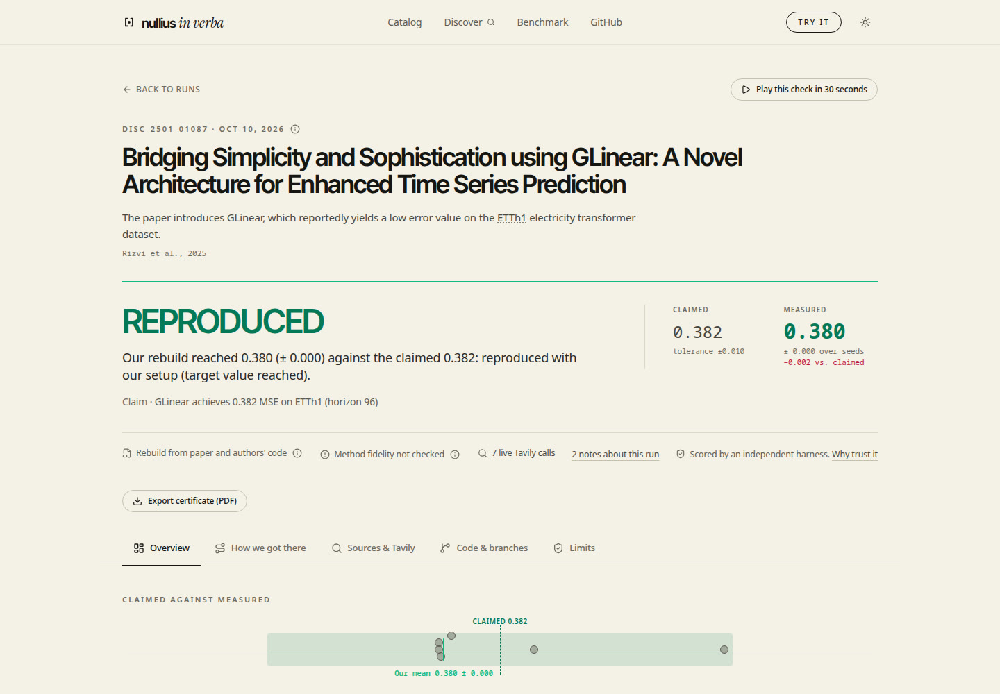
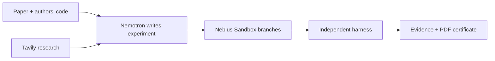

<div align="center">

<picture>
  <source media="(prefers-color-scheme: dark)" srcset="docs/img/nullius-logo-dark.svg">
  
</picture>

### Here, the paper is the test suite.

A machine learning paper makes a claim. Nullius writes an experiment, runs it in an isolated sandbox, and independently measures whether the target is reached.

**NVIDIA Nemotron · Nebius Token Factory · Nebius Sandboxes · Tavily**

[Try the demo](https://nullius.akca.dev/) · [Explore the evidence](#three-recent-checks) · [Run locally](#run-locally) · [How it works](#how-it-works) · [Evaluation](#what-we-measured) · [MIT licence](LICENSE)

</div>

<picture>
  <source media="(prefers-color-scheme: dark)" srcset="docs/img/readme-home-dark.jpg">
  
</picture>

Built for the **Nebius × NVIDIA Global AI Hackathon**, Coding and Agentic Engineering, with Tavily for discovery and evidence research. *Nullius in verba* means “take nobody’s word for it.”

**Publication status:** the [hosted demo](https://nullius.akca.dev/) is reachable (checked 12 Oct 2026). Recorded evidence is open without sign-in; fresh runs depend on live admission limits. The new submission video and Devpost entry are not published yet. You can also browse the stored [certificates](#three-recent-checks) here or preview the product locally without API keys.

## From a paper to a decision

Before you build on a reported result, check what you can reach with your setup. Nullius puts three things next to each other: **what the paper claims, what the experiment measured, and the evidence behind the verdict**.

1. **Read.** Find the paper, target value, repository and setup details, with quotations and source provenance.
2. **Rebuild.** Nemotron reads the paper and authors’ code as reference material, then writes its **own** experiment. The authors’ program is never executed.
3. **Measure.** Sandbox branches run the generated program. An independent harness scores its predictions against a target and tolerance fixed before the run.
4. **Inspect and keep.** Follow sources, code, repairs and measurements. Save the certificate as a **PDF** using the browser print preview.

The result helps a reviewer, PhD student or ML team decide what to investigate before relying on a paper. We have not measured time savings or completed a user study.

## Three recent checks

Three papers reached their fixed numerical targets on **ETTh1**, forecast horizon **96**, with **three seeds each** and tolerance **±0.01 MSE**. MSE is prediction error; lower is better.

| Paper | Paper claims | Nullius measured, mean ± std | Gross inference cost | Stored certificate |
|---|---:|---:|---:|---|
| **TSMixer** · Google | 0.361 | **0.3624 ± 0.0003** | $0.2354 | [Read evidence](web/public/data/disc_2303_06053/20261009-201230/zeugnis.md) |
| **SparseTSF** | 0.359 | **0.3653 ± 0.0034** | $0.2035 | [Read evidence](web/public/data/disc_2405_00946/20261009-220822/zeugnis.md) |
| **GLinear** | 0.3820 | **0.3796 ± 0.0003** | $0.2047 | [Read evidence](web/public/data/disc_2501_01087/20261010-161916/zeugnis.md) |

**Preliminary · method fidelity not checked.** These are manually selected examples after development, outside the eight development units. They are not a blind test or a general success rate. Costs include configured VAT; Tavily and sandbox costs are separate.

TSMixer retains protocol and table-column warnings. GLinear’s target was checked manually before the run; automatic target extraction returned no JSON and automatic column assignment remained unchecked. Those warnings stay in its certificate. See the [GLinear completion record](docs/paper_candidates_20261010.md#abschluss-glinear), [catalog](benchmark/catalog.yaml), and stored dossiers and event logs beside each certificate.

**Failed checks stay visible.** SL-GCN missed its target; HaKAN failed in setup. Acacia has no completed catalog verdict and remains unchecked. A miss can reflect an agent or setup weakness; it does not prove the paper wrong.

## The product

**Overview → recorded check → source → generated code → measurements → PDF.** The main path works with stored evidence; you can inspect it without starting a paid experiment.

<picture>
  <source media="(prefers-color-scheme: dark)" srcset="docs/img/readme-glinear-dark.jpg">
  
</picture>

| Page | What you can do |
|---|---|
| **Overview** | Open a finished check or its labelled recorded replay. |
| **Discover** | Let Tavily find papers on supported datasets. A fresh search uses service credits. |
| **Catalog** | Browse successful checks, failed checks and unchecked candidates. |
| **Live run** | Watch sources, plan, generated code, repairs and measurements arrive. A fresh run makes paid calls. |
| **Evidence** | Inspect the claim, source quotations, code, branch tree and per-seed measurements; export a PDF certificate. |

The **What-if** control changes the target, while measured predictions stay fixed. Result charts, seed measurements, replay and PDF use the selected attempts that contribute to the recorded verdict. Other candidates and repairs remain in the branch tree. Legacy runs without selection markers retain their recorded measured attempts. PDF export always uses the stored result, including its limitations.

## What we measured

Each evaluation answers a different question. We report the counts separately.

| Evaluation | Observed result | What the count means |
|---|---|---|
| **Paper and authors’ code: development** | **7/8** | Development units matching the reference verdict; **in-sample**, after fixes were designed using those units. Includes agreement with a partial reference verdict. |
| **Same evaluation: RLinear held-out** | **0/1** | Separate paper excluded from the design of those fixes; reference verdict missed. |
| **Same evaluation: planted controls** | **0/9 confirmed** | Eight rejected; one without a verdict after a setup failure. |
| **Earlier paper-only v4** | **2/8** with Tavily; **1/8** without | Majority verdicts matching the reference, three generations per unit and arm, 48 runs. |
| **v4 planted controls** | **0/48 confirmed** | Deliberately false targets; a negative control within this benchmark. |

In v4, all **7 target-reached verdicts** for real claims agreed with our reference solution (post hoc, small sample). This does not establish a universal precision guarantee. The authors’-code run used different models and counting rules and stored source fixtures; **do not pool the counts or claim a measured Tavily accuracy gain**. The pre-registered rule for claiming a recall improvement required the RLinear held-out check to pass, and it did not.

“Target reached” describes the numerical result with our setup. **Method fidelity is not checked**, and overall conclusions remain provisional. Our checker missed three calibration thresholds (5/10, 7/10, 8/11); we report those failures too.

[Author-code evaluation](benchmark/experiments/results/recall_cg_v1.md) · [Benchmark v4](benchmark/experiments/results/benchmark_v4.md) · [Benchmark history](docs/benchmark_history.md) · [Detailed evaluation and research notes](docs/evaluation_notes.md)

## Our own small bitter lesson

Reading the authors' code improved reference-verdict agreement on our eight development units. This was an in-sample observation; the separate held-out RLinear check missed. [Read the full lesson, evidence and limits](docs/evaluation_notes.md#our-own-small-bitter-lesson).

## How it works



**Default: rebuild from the paper and authors’ code.** Public repository files are read as text. If reference code is unavailable, the product falls back to a paper rebuild and displays the actual mode. `--no-author-code` selects the paper-only mode explicitly.

**Independent measurement.** The generated program supplies `/output/predictions.csv`. The harness is copied in fresh, loads test labels from the original dataset, checks the predictions and computes the metric. The verdict uses the mean over seeds against the fixed tolerance. Training has no network; static checks reject network access, downloads and process spawning.

**Attempts remain inspectable.** Smoke checks, trivial baselines, graph ablations and repair events help distinguish an agent failure from a numerical miss. A result below a trivial baseline is flagged “agent fault suspected”. A failed attempt and its code version remain in the evidence.

| Component | Role |
|---|---|
| **Nemotron 3 Super on Token Factory** | Plans, writes and repairs code; extracts setup details. |
| **Nemotron 3.5 Lightning on Token Factory** | Extracts target values. |
| **Nebius Sandboxes** | Isolated execution, snapshot branches for attempts and seeds. |
| **Tavily** | Search and Extract for discovery, source text, setup and errors; limited Crawl for community sources. |
| **Python / FastAPI** | Orchestration, recorded evidence, live events and admission controls. |
| **React / Vite** | Product pages, replay, source inspection and PDF print preview. |

Historical v2–v4 runs used Nemotron Ultra for planning before its removal on 9 Oct 2026; current runs use Super. Each run records the models it used.

Tavily sources carry mode, timestamp and SHA-256. Community findings are reported separately after the verdict; when a finding can be tested, it may become an additional measured experiment. These experiments do not change the original verdict. [Examples and the failed automatic `drop_last` search](docs/evaluation_notes.md#how-we-use-tavily).

## Run locally

### Browse recorded evidence — no API keys

Requires **Node 22**. From the repository root:

```bash
cd web
npm ci
npm run dev
```

Open the local URL printed by Vite. The finished checks, sources, code, What-if control and certificate print preview use stored data. Fresh live checks require the backend and credentials.

### Run the agent and live backend

Requires **Python 3.11+**, [uv](https://docs.astral.sh/uv/), a Nebius Token Factory key, a Nebius Sandboxes project and a Tavily key. From the repository root:

```bash
cp .env.example .env
# Fill NEBIUS_API_KEY, NEBIUS_PROJECT_ID and TAVILY_API_KEY.
# Set LLM_PROVIDER=tokenfactory and reconcile budgets with current balances.
uv sync

# This starts a paid experiment on a configured reference paper.
uv run repro-agent kipf_gcn_2017

# In a separate terminal at the repository root:
uv run uvicorn repro_agent.api:app --port 8000
```

CLI options: `--no-author-code` for paper-only mode, `--no-tavily` to disable Tavily, `--offline` for stored Tavily fixtures, `--fresh` to bypass the LLM cache. Stored sources do not by themselves make model calls free.

Configuration: [.env.example](.env.example). Runs: `runs/<paper>/<timestamp>/`. Selected production evidence is exported to `web/public/data/` using `scripts/export_site_data.py`. Container hosting: [deployment guide](docs/deploy.md).

### Verify locally

From the repository root:

```bash
uv run python -m pytest -m "not integration"
```

In the `web` directory:

```bash
npm run build
npm run lint
npm test
```

## Scope and next steps

- **Supported:** Cora (Planetoid and random splits), CiteSeer (Planetoid split), ETTh1 (forecast horizon 96). CPU experiments on small models. PubMed and other ETT datasets remain unreleased after reference validation misses: [validation results](benchmark/experiments/results/datasets_v2_validation.md).
- **Unverified:** method fidelity, general performance on unseen papers and user time savings. Executing the authors’ own program is not a product mode.
- **Live controls:** admission floors, daily/per-IP limits and recorded fallback exist. The 10 Oct production fix added shared per-job inference budgets, durable request reservations, Tavily credit reservations and cooperative timeout cancellation. Offline tests verify the controls; provider prices, actual balances, sandbox/hosting costs and spending from other machines remain outside that proof. [Cost-policy review](docs/cost_policy_review.md#production-fix--10-oct-after-review).
- **Next:** one person tests the finished product. Their observations precede decisions about further live-demo steps and author outreach. [Test plan](docs/product_test_20261010.md). TimeBase, then SOFTS, remain candidates; no new paid paper runs are being started.

## Repository guide

| Path | Contents |
|---|---|
| [src/repro_agent](src/repro_agent) | Orchestrator, provider clients, API and sandbox adapters. |
| [harness](src/repro_agent/harness) | Independent metrics and verification checks. |
| [web](web) | React product and stored production evidence. |
| [benchmark](benchmark) | Claims, protocols, reference solutions and evaluation results. |
| [docs](docs) | Research notes, deployment, video and submission drafts. |

## Related work

[PaperBench](https://arxiv.org/abs/2504.01848) evaluates full paper replication against detailed rubrics. [CORE-Bench](https://arxiv.org/abs/2409.11363) evaluates computational reproducibility using supplied code and data. Nullius focuses on a smaller unit: a reported numerical claim, a generated rebuild and an independent measurement you can inspect.

## Licence

[MIT](LICENSE). Dataset licences are separate. Datasets are downloaded from their original sources at run time, not redistributed here. Planetoid’s source repository carries an MIT licence; ETT’s source repository carries CC BY-ND 4.0. See the [dataset validation notes](benchmark/experiments/results/datasets_v2_validation.md) and original sources for their terms.
