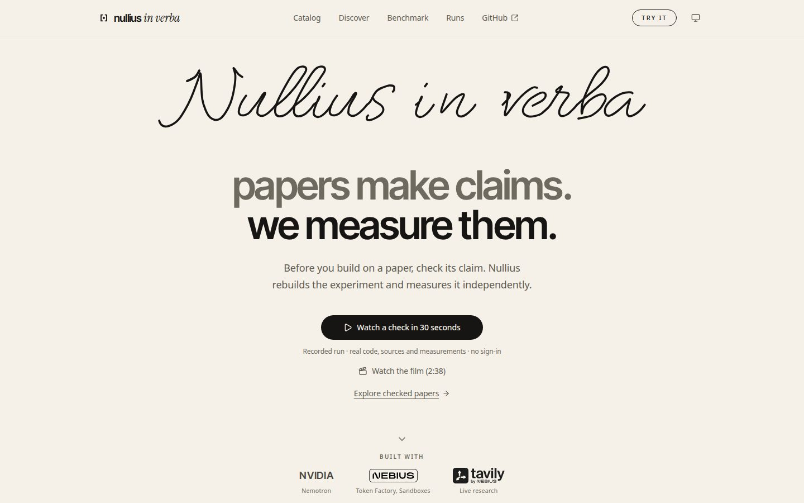
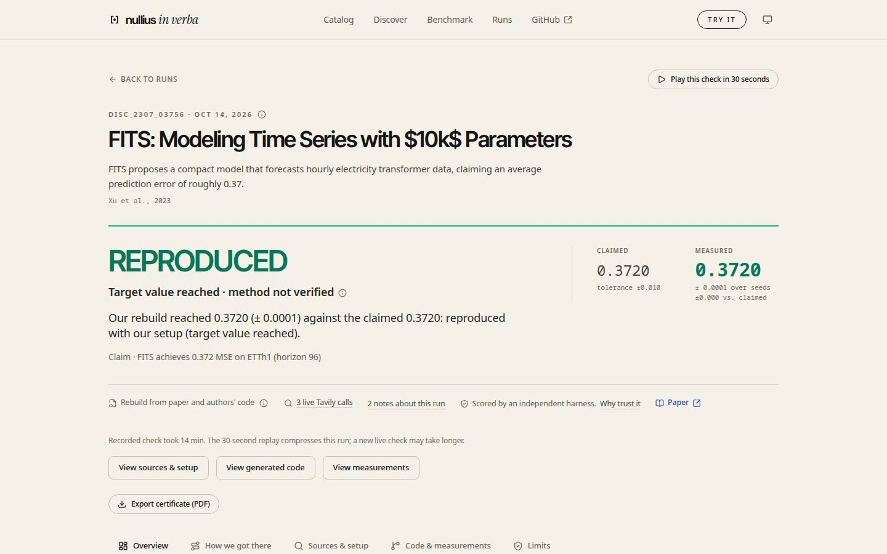
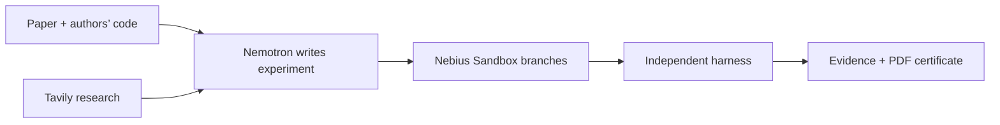

<div align="center">

<picture>
  <source media="(prefers-color-scheme: dark)" srcset="docs/img/nullius-logo-dark.svg">
  
</picture>

### Here, the paper is the test suite.

**The problem.** Many machine learning results are hard to reproduce, and checking one claim by hand can take days. In a [2016 *Nature* survey](https://www.nature.com/articles/533452a) of 1,576 researchers, more than 70% said they had tried and failed to reproduce another scientist’s experiment.

**Who it is for.** Reviewers, PhD students and ML teams who want to know whether a reported number holds before they build on it.

**The idea.** The paper is the test suite. A paper states a target value. Nullius writes its own experiment, runs it in an isolated sandbox, and an independent harness measures whether the target is reached. We also plant a deliberately false claim next to real ones: in our benchmark, none of the 48 planted claims was accepted as reproduced.

**NVIDIA Nemotron · Nebius Token Factory · Nebius Sandboxes · Tavily**

[Try the demo](https://nullius.akca.dev/) · [Watch the film](VIDEO_URL_TBD) · [Evidence](#checks-you-can-open) · [Built on Nebius and NVIDIA](#built-on-nebius-and-nvidia) · [Run locally](#run-locally) · [Evaluation](#what-we-measured) · [MIT licence](LICENSE)

</div>

<picture>
  <source media="(prefers-color-scheme: dark)" srcset="docs/img/readme-home-dark.jpg">
  
</picture>

Built for the **Nebius × NVIDIA Global AI Hackathon**, Coding and Agentic Engineering, with Tavily for discovery and evidence research. *Nullius in verba* means “take nobody’s word for it.”

**Demo:** [nullius.akca.dev](https://nullius.akca.dev/), open without sign-in. Video: [VIDEO_URL_TBD](VIDEO_URL_TBD). Live runs cost real money, so the server admits a limited number per day; when a live run is not available, the page offers a labelled recorded replay of a real run.

### Try it in two minutes

1. Open the [demo](https://nullius.akca.dev/) and choose **Catalog**.
2. Pick **FITS**, **Kipf GCN on Cora** or **GLinear**. These three are open for a fresh check.
3. Start a check. A readiness check runs before any paid step, and the run ends in a verdict or an explained stop. Or press **Watch a check in 30 seconds** for a recorded replay with no waiting.
4. Open **Discover** to let Tavily search for new papers on supported datasets.

## From a paper to a decision

Before you build on a reported result, check what you can reach with your setup. Nullius puts three things next to each other: **what the paper claims, what the experiment measured, and the evidence behind the verdict**.

1. **Read.** Find the paper, target value, repository and setup details, with quotations and source provenance.
2. **Rebuild.** Nemotron reads the paper and authors’ code as reference material, then writes its **own** experiment. The authors’ program is never executed.
3. **Measure.** Sandbox branches run the generated program. An independent harness scores its predictions against a target and tolerance fixed before the run.
4. **Inspect and keep.** Follow sources, code, repairs and measurements. Save the certificate as a **PDF** using the browser print preview.

The result helps a reviewer, PhD student or ML team decide what to investigate before relying on a paper. We have not measured time savings or completed a user study.

## Checks you can open

Three papers are open for a fresh check in the demo. Each ran with **three or more seeds** and a tolerance fixed before the run (**±0.01**: MSE for the two forecasting papers, accuracy for Kipf). Lower MSE is better; accuracy is the share of correct labels.

| Paper | Dataset | Paper claims | Nullius measured, mean ± std | Seeds | Gross inference cost | Stored certificate |
|---|---|---:|---:|---:|---:|---|
| **FITS** (autonomous live run, 14 Oct 2026) | ETTh1, horizon 96 | 0.372 | **0.37203 ± 0.00005** | 3 | $0.3101 | [Read evidence](web/public/data/disc_2307_03756/20261014-080542/zeugnis.md) |
| **Kipf & Welling GCN** | Cora | 0.815 | **0.8146 ± 0.0077** | 9 | $0.1884 | [Read evidence](web/public/data/disc_1609_02907/20261009-160716/zeugnis.md) |
| **GLinear** | ETTh1, horizon 96 | 0.3820 | **0.3796 ± 0.0003** | 3 | $0.2047 | [Read evidence](web/public/data/disc_2501_01087/20261010-161916/zeugnis.md) |

**FITS is the strongest case.** The run started on the deployed server and ran without human edits: the specification matched the paper’s settings 9 of 9, and the three seeds landed within 0.0001 of the claim. [Run record](docs/audits/fits_live_a514edeb_20261014.json) · [what we fixed to get there](docs/fits_code_generation_fixes_20261014.md).

**Preliminary · method fidelity not checked.** “Reproduced” means the target number was reached with our setup, not that the method was verified. These are hand-picked examples after development, not a blind test or a general success rate. Costs include VAT; Tavily and sandbox costs are separate. The FITS certificate keeps a note that its table column was not checked; GLinear’s target was checked manually and its certificate lists the same kind of warnings. See the [GLinear completion record](docs/paper_candidates_20261010.md#abschluss-glinear) and the [catalog](benchmark/catalog.yaml).

**Other recorded results, with their notes.** TSMixer (0.3624 vs 0.361) was recorded with a smaller model than the paper (1 block, hidden size 128 instead of 6 and 512). SparseTSF (0.3653 vs 0.359) used the linear variant and input length 720; a new check is locked because the authors’ launch script does not name the variant. BANGS reached 0.819 against 0.842, a partial match that takes about 80 minutes on CPU. The site shows these as dated “Recorded” cards.

**Failed checks stay visible.** SL-GCN missed its target (0.595 vs 0.829); HaKAN failed in setup. Acacia has no completed verdict. A miss can reflect an agent or setup weakness; it does not prove the paper wrong.

## The product

**Overview → recorded check → source → generated code → measurements → PDF.** The main path works with stored evidence; you can inspect it without starting a paid experiment.

<picture>
  <source media="(prefers-color-scheme: dark)" srcset="docs/img/readme-fits-dark.jpg">
  
</picture>

| Page | What you can do |
|---|---|
| **Overview** | Open a finished check or its labelled recorded replay. |
| **Discover** | Let Tavily find papers on supported datasets. A fresh search uses service credits. |
| **Catalog** | Browse successful checks, failed checks and unchecked candidates. |
| **Live run** | Watch sources, plan, generated code, repairs and measurements arrive. A fresh run makes paid calls. |
| **Evidence** | Inspect the claim, source quotations, code, branch tree and per-seed measurements; export a PDF certificate. |

The **What-if** control changes the target, while measured predictions stay fixed. Charts, seed tables, replay and PDF show the attempts behind the verdict. Other candidates and repairs stay in the branch tree. PDF export always includes the stored result and its limitations.

## What we measured

Each evaluation answers a different question. We report the counts separately.

| Evaluation | Observed result | What the count means |
|---|---|---|
| **Paper and authors’ code: development** | **7/8** | Development units matching the reference verdict; **in-sample**, after fixes were designed using those units. Includes agreement with a partial reference verdict. |
| **Same evaluation: RLinear held-out** | **0/1** | Separate paper excluded from the design of those fixes; reference verdict missed. |
| **Same evaluation: planted controls** | **0/9 confirmed** | Eight rejected; one without a verdict after a setup failure. |
| **Earlier paper-only v4** | **2/8** with Tavily; **1/8** without | Majority verdicts matching the reference, three generations per unit and arm, 48 runs. |
| **v4 planted controls** | **0/48 confirmed** | Deliberately false targets; a negative control within this benchmark. |

In v4, all **7 target-reached verdicts** for real claims agreed with our reference solution (post hoc, small sample). This does not establish a universal precision guarantee. The authors’-code run used different models and counting rules and stored source fixtures; **do not pool the counts or claim a measured Tavily accuracy gain**. The pre-registered rule for claiming a recall improvement required the RLinear held-out check to pass, and it did not.

“Target reached” describes the numerical result with our setup. **Method fidelity is not checked**, and overall conclusions remain provisional. Our checker missed three calibration thresholds (5/10, 7/10, 8/11); we report those failures too.

[Author-code evaluation](benchmark/experiments/results/recall_cg_v1.md) · [Benchmark v4](benchmark/experiments/results/benchmark_v4.md) · [Benchmark history](docs/benchmark_history.md) · [Detailed evaluation and research notes](docs/evaluation_notes.md)

## Our own small bitter lesson

Reading the authors' code improved reference-verdict agreement on our eight development units. This was an in-sample observation; the separate held-out RLinear check missed. [Read the full lesson, evidence and limits](docs/evaluation_notes.md#our-own-small-bitter-lesson).

## How it works



**Default: rebuild from the paper and authors’ code.** Public repository files are read as text. If reference code is unavailable, the product falls back to a paper rebuild and displays the actual mode. `--no-author-code` selects the paper-only mode explicitly.

**Independent measurement.** The generated program supplies `/output/predictions.csv`. The harness is copied in fresh, loads test labels from the original dataset, checks the predictions and computes the metric. The verdict uses the mean over seeds against the fixed tolerance. Training has no network; static checks reject network access, downloads and process spawning.

**Attempts remain inspectable.** Smoke checks, trivial baselines, graph ablations and repair events help distinguish an agent failure from a numerical miss. A result below a trivial baseline is flagged “agent fault suspected”. A failed attempt and its code version remain in the evidence.

| Component | Role |
|---|---|
| **Nemotron on Token Factory** | Plans, writes and repairs code; extracts setup details and targets. |
| **Nebius Sandboxes** | Isolated execution, snapshot branches for attempts and seeds. |
| **Tavily** | Discovery, source text, setup details, error search, community check. |
| **Python / FastAPI** | Orchestration, recorded evidence, live events and admission controls. |
| **React / Vite** | Product pages, replay, source inspection and PDF print preview. |

## Built on Nebius and NVIDIA

**How Nemotron is used.** Nemotron does the reading, writing and judging; it never runs code. Each role has its own model, set in `.env`:

| Role | Model on Token Factory | Job |
|---|---|---|
| `code`, `extract`, `reasoning` | **Nemotron 3 Super** (`nemotron-3-super-120b-a12b`) | Writes the research plan, writes and repairs the experiment code, extracts setup details with word-for-word quotes, writes the final verdict text. |
| `fast` | **Nemotron 3.5 Lightning** | Reads target values from tables and triages short outputs. |

Nemotron 3 Ultra handled plan and verdict in benchmark v2–v4 until Token Factory removed it on 9 Oct 2026; Super has done all roles since. Each stored run records the models it used.

**Where Token Factory helped.**
- **One OpenAI-compatible endpoint, switched by `.env`.** We prototyped on free OpenRouter endpoints and moved to Token Factory by changing `LLM_PROVIDER` and the model IDs. The only provider-specific code is the LLM client (`src/repro_agent/llm.py`).
- **Cost we could read per call.** The API returns `usage` including reasoning tokens. We log every call to `logs/costs.jsonl`, apply budget guards before each call (warning at 80%, stop at 95%) and enforce a per-run cap. Our log matched the console within rounding on 2 Oct 2026 ([feedback](docs/nebius_feedback.md), item E13).
- **Cheap enough to measure.** A typical check costs about $0.2–0.3 gross (see the table above). A 48-run benchmark cost $3.60 (v2) and $3.10 (v3) gross, so every change to the agent could be tested against the full set.

**Nebius services used.**
- **Nebius Sandboxes** (`contree-sdk`): every experiment runs in a sandbox branch. One snapshot holds Python, the data and the harness; each attempt and each seed branches from it, so seeds run in parallel (up to 4 at a time by default; 20 parallel branches ran without error on 28 Sep 2026). Training runs without network access.
- **Nebius Token Factory**: all model calls, as above.

Our notes on what worked and what hurt, with evidence for each item: [Feedback on Token Factory, Sandboxes and Nemotron](docs/nebius_feedback.md).

## Tavily at run time

A normal run calls Tavily live, and each stored source carries its mode, timestamp and SHA-256:

| Step | Tavily call | What it answers |
|---|---|---|
| Discovery | Search | Which new papers report a claim on a dataset we support? |
| Claim source | Extract | What does the paper’s table say, and where? |
| Setup details | Extract on the README and configs | Which hyperparameters and splits does the repository use? Each value needs a quote. |
| Errors | Search with the error text | How do others fix this failure? |
| Community check | Search, limited Crawl | What do issues and critiques say? Reported after the verdict; the verdict never changes. |

In the FITS run above, the Evidence page shows “3 live Tavily calls” (the repository README and two error searches); its paper text came from a stored copy of the LaTeX source. We use Tavily as a product capability (finding and citing sources), not as a measured accuracy gain: our benchmark showed no reliable difference with or without it. [Examples and the failed automatic `drop_last` search](docs/evaluation_notes.md#how-we-use-tavily).

## Run locally

### Browse recorded evidence — no API keys

Requires **Node 22**. From the repository root:

```bash
cd web
npm ci
npm run dev
```

Open the local URL printed by Vite. The finished checks, sources, code, What-if control and certificate print preview use stored data. Fresh live checks require the backend and credentials.

### Run the agent and live backend

Requires **Python 3.11+**, [uv](https://docs.astral.sh/uv/), a Nebius Token Factory key, a Nebius Sandboxes project and a Tavily key. From the repository root:

```bash
cp .env.example .env
# Fill NEBIUS_API_KEY, NEBIUS_PROJECT_ID and TAVILY_API_KEY.
# Set LLM_PROVIDER=tokenfactory and reconcile budgets with current balances.
uv sync

# This starts a paid experiment on a configured reference paper.
uv run repro-agent kipf_gcn_2017

# In a separate terminal at the repository root:
uv run uvicorn repro_agent.api:app --port 8000
```

CLI options: `--no-author-code` for paper-only mode, `--no-tavily` to disable Tavily, `--offline` for stored Tavily fixtures, `--fresh` to bypass the LLM cache. Stored sources do not by themselves make model calls free.

Configuration: [.env.example](.env.example). Runs: `runs/<paper>/<timestamp>/`. Selected production evidence is exported to `web/public/data/` using `scripts/export_site_data.py`. Container hosting: [deployment guide](docs/deploy.md).

### Verify locally

From the repository root:

```bash
uv run python -m pytest -m "not integration"
```

In the `web` directory:

```bash
npm run build
npm run lint
npm test
```

## Scope and next steps

- **Supported:** Cora (Planetoid and random splits), CiteSeer (Planetoid split), ETTh1 (forecast horizon 96). CPU experiments on small models. PubMed and other ETT datasets remain unreleased after reference validation misses: [validation results](benchmark/experiments/results/datasets_v2_validation.md).
- **Unverified:** method fidelity, general performance on unseen papers and user time savings. Executing the authors’ own program is not a product mode.
- **Live controls:** admission floors, daily and per-IP limits, a per-run cost cap and the recorded fallback exist. Offline tests verify them; real provider prices, balances and hosting costs are outside that proof. [Cost-policy review](docs/cost_policy_review.md#production-fix--10-oct-after-review).

### Where this goes next

No promises, only direction: more datasets (each needs one task and one harness, built once), a check of whether the generated code follows the paper’s method, and a GPU tier for papers that CPU cannot run (one claim failed for that reason: its model needs a CUDA kernel library).

## Repository guide

| Path | Contents |
|---|---|
| [src/repro_agent](src/repro_agent) | Orchestrator, provider clients, API and sandbox adapters. |
| [harness](src/repro_agent/harness) | Independent metrics and verification checks. |
| [web](web) | React product and stored production evidence. |
| [benchmark](benchmark) | Claims, protocols, reference solutions and evaluation results. |
| [docs](docs) | Research notes, deployment, video and submission drafts. |

## Related work

[PaperBench](https://arxiv.org/abs/2504.01848) evaluates full paper replication against detailed rubrics. [CORE-Bench](https://arxiv.org/abs/2409.11363) evaluates computational reproducibility using supplied code and data. Nullius focuses on a smaller unit: a reported numerical claim, a generated rebuild and an independent measurement you can inspect.

## Licence

[MIT](LICENSE). Dataset licences are separate. Datasets are downloaded from their original sources at run time, not redistributed here. Planetoid’s source repository carries an MIT licence; ETT’s source repository carries CC BY-ND 4.0. See the [dataset validation notes](benchmark/experiments/results/datasets_v2_validation.md) and original sources for their terms.
