# Nullius

**Other agents fix code until the tests pass. Here, the paper is the test suite.**

*Nullius in verba* ("take nobody's word for it"): Nullius takes a claim from a machine-learning paper, rebuilds the experiment in an isolated sandbox and lets an independent harness measure the result. The verdict is a measurement, not an opinion.

**The problem.** Rebuilding a paper costs days of broken code and missing hyperparameters, and whether a claim holds is usually known only after someone has paid that price.

[Demo](TBD) | [Video](TBD) | Built for the Nebius x NVIDIA Global AI Hackathon (Coding and Agentic Engineering, Best Use of Tavily) | MIT | <https://github.com/Script-hpp/Nullius>

<picture>
  <source media="(prefers-color-scheme: dark)" srcset="docs/img/overview-dark.jpg">
  
</picture>

## Contents

[What the benchmark shows](#what-the-benchmark-shows) · [Our own small bitter lesson](#our-own-small-bitter-lesson) · [Who uses it](#who-uses-it-and-how) · [Product tour](#product-tour) · [How it works](#how-it-works) · [Nemotron](#how-we-use-nvidia-nemotron) · [Token Factory](#where-nebius-token-factory-helped) · [Sandboxes](#other-nebius-services-sandboxes) · [Tavily](#how-we-use-tavily) · [Benchmark](#benchmark) · [Related work](#related-work) · [Setup](#setup-and-usage) · [Limits](#limitations-and-roadmap)

## What the benchmark shows

Nullius is a **high-precision checker**: when it says a target value was reached, it was; it has never reported a deliberately wrong claim as reproduced. How often it reaches the target depends on what the agent is allowed to read. Two modes, two separate measurements; the numbers are never added up.

| | Result | Status |
|---|---|---|
| **Precision** | **0 of 48** deliberately wrong (placebo) claims reported as "reproduced" in benchmark v4, also 0 of 48 in each of v2 and v3; **0 of 9** in the authors'-code run | pre-registered negative control |
| **Precision** | **7 of 7** "reproduced" verdicts in v4 agree with the reference solution | post hoc, small sample |
| **Recall, paper only** (v4, 48 runs) | **2 of 8** paper-claim units matched the reference verdict with Tavily, **1 of 8** without | pre-registered primary metric |
| **Recall, paper and authors' code** (default mode, one run, 22 counted runs) | **7 of 8** development units matched; the one held-out paper (RLinear) missed, **0 of 1** | development units are **in-sample**; see the next section |

**Method fidelity was not checked.** "Reproduced" means "target value reached according to the harness", not "method reproduced". Details: [Benchmark](#benchmark).

## Our own small bitter lesson


**What we did for days.** Benchmark v3 and v4 each came after a failure analysis of the run before, and each added engineering to make the agent cleverer: better code extraction, repair after timeouts, Tavily error search, three code candidates chosen by a validation metric, checks for prediction-to-node mapping, a graph repair loop. Agreement with the reference verdicts stayed at **2 of 8** (v2: 2 / 2, v3: 2 / 2, v4: 1 / 2 without / with Tavily; [`docs/benchmark_history.md`](docs/benchmark_history.md)). Around it we tried more, all with rules fixed before the run, and most missed their rule:

| What we tried | Outcome |
|---|---|
| Setup details from paper and README (role 4), DLinear and Shchur | rule missed; Shchur by 0.0004 (`results/role4_dlinear.md`, `role4_shchur.md`) |
| Tavily objection search before the experiment (role 3) | no protocol objection found (`results/role3_dlinear_stage1.md`) |
| v5 steps A and C (dossier fidelity, trial run) | not passed, no v5 (`results/v5_step_a.md`, `v5_step_c.md`) |
| An LLM checker for method fidelity, three calibrations | 5/10, 7/10, 8/11 correct, all below the threshold set before; axis 2 stays "not checked" (`results/calibration_fidelity_v1.md` to `_v3.md`) |
| "Re-run" mode that executes the authors' code | works on the two repositories it was built on, **0 of 4** on new ones, twice (`results/nachlauf_v1.md`); not in the product |

A post hoc analysis of all stored generations ([`docs/recall_analysis_3.md`](docs/recall_analysis_3.md)) explained why: per-generation hit rates predicted **1.96 of 8**, so 2 of 8 was the system's equilibrium, not bad luck. A unit only matches when every decisive detail is right, and for at least five of the eight units a decisive detail **exists only in the authors' repository, not in the paper**: the learning-rate halving per epoch (DLinear, NLinear), the early-stopping rule (GAT), a tuned weight decay that sits in a pickled file (SGC). No amount of prompt cleverness can use a fact that never reaches the prompt.

**What changed the number.** We gave the code model the authors' code itself: a verbatim excerpt of the public repository (model file, helper functions, start script, configs) goes into the plan, code and repair prompts, and a fact sheet enforces the numeric settings found there. The code is read as text, **never executed**; the agent still writes its own script and our harness still measures it. Before paying for the full run we ran two small pre-registered gates. G0 was stopped incomplete (50 of 54 samples; on the development units the authors'-code arm hit the reference verdict in 8 samples against 4 for the paper-only product (16 finished samples each), the pre-registered rule asked for a lead of 5, so it counts as neither passed nor failed). G1, on the two GAT units, passed a low bar (`results/recall_cg_gate.md`, `results/recall_cg_gate_g1.md`). The full run, **recall cg v1** (rules in [`recall_cg_v1.md`](benchmark/experiments/recall_cg_v1.md), committed before the first model call; results in [`results/recall_cg_v1.md`](benchmark/experiments/results/recall_cg_v1.md)):

| Unit | Reference verdict | Paper only (v4, with Tavily) | Paper and authors' code (generation 0 / 1 / 2) |
|---|---|---|---|
| Kipf & Welling, GCN | reproduced | reproduced, match | reproduced / reproduced, **match** |
| Wu et al., SGC | reproduced | not reproduced | reproduced / reproduced, **match** |
| Zeng et al., DLinear | reproduced | partially | reproduced / reproduced, **match** |
| Zeng et al., NLinear | reproduced | not reproduced | reproduced / not reproduced / not reproduced, miss |
| Shchur et al., GCN | reproduced | reproduced, match | reproduced / reproduced, **match** |
| Shchur et al., GAT | reproduced | partially | partially / reproduced / reproduced, **match** |
| Veličković et al., GAT | reproduced | partially | setup failure / reproduced / reproduced, **match** |
| Veličković et al., DGI | partially | not reproduced | partially / reproduced / partially, **match** |
| **Development units matching** | | **2 of 8** | **7 of 8** (in-sample) |
| Li et al., RLinear (**held-out**) | reproduced | not in v4 | not reproduced / not reproduced, miss: **0 of 1** |

Placebo claims in the same run: **0 of 9 confirmed** (8 rejected, 1 without a verdict because that generation failed in setup). Cost: 5.49 $ gross for the 22 counted runs (7.45 $ including an aborted first attempt, when Token Factory removed Ultra mid-run). A live check of the product default on 9 Oct 2026 (Kipf & Welling, 3 seeds, Nebius and Token Factory): reproduced, **0.8213 ± 0.0021** against 0.815, 9.6 minutes, 0.139 $ gross ([run](web/public/data/disc_1609_02907/20261009-115012/zeugnis.md)).

**The bitter lesson, our version.** Rich Sutton's essay [The Bitter Lesson](http://www.incompleteideas.net/IncIdeas/BitterLesson.html) (2019) makes one point that researchers keep relearning the hard way: "general methods that leverage computation are ultimately the most effective, and by a large margin", and the human knowledge we build into our systems helps in the short term but plateaus. Our small, related lesson is not the same one. We did not scale computation; we spent days of hand-built cleverness (prompts, repair rules, a checker) and gained little, while **more and better information** moved the count: *the missing details were in the authors' code, not in a cleverer prompt.* It cuts both ways: the held-out RLinear miss is again a detail that never reached the prompt (learning-rate halving per epoch, in the authors' `exp_main.py`; plus three input defects, [`docs/rlinear_cg_v1_analysis.md`](docs/rlinear_cg_v1_analysis.md), post hoc and not proven by an ablation). We learned this on eight units, in-sample, with one held-out miss. It is an observation, not a proof.

**What this does not show.**
- **In-sample.** The fixes were designed after seeing these eight units. The only held-out paper missed in both generations (0.487 and 0.432 against a target of 0.366).
- **"Recall improved" is not claimed.** Our pre-registered reading rule required the held-out check as well, and it failed. The allowed statement is exactly the three numbers above (7 of 8 in-sample, 0 of 1 held-out, 0 of 9 placebos), and v4 (2 of 8) and this run are **never summed or netted** into one gain.
- **Generation variance is large.** Four of the eight units needed a third generation; for three of the seven matches (Shchur-GAT, Veličković-GAT, DGI) the unit verdict hangs on that one generation, and NLinear flipped from a match to a miss. Counted per single generation, 15 of 22 verdicts matched the reference (post hoc).
- **Different mode, models and rules.** This run used Nemotron 3 Super in every role (Ultra was removed from Token Factory on 2026-10-09), stored Tavily results in place of live calls, the error search switched off, placebos only in generation 0, an adaptive third generation and a higher cost cap. It is not comparable with v4 under the v2 rules, and it says nothing about Tavily's contribution.
- **Not "from the paper alone" any more.** The verdict now means "the target was reached by our rebuild of the method as paper **and code** define it, measured by our harness". Every certificate names its mode. Method fidelity is not checked.

## Who uses it, and how

- **A reviewer** meets a paper that claims a number on a supported benchmark ("GCN reaches 81.5 % on Cora"). Nullius rebuilds the experiment and measures it over several seeds: [Kipf & Welling, reproduced 0.815 ± 0.011, 10 seeds, about 10 minutes, 0.139 $ gross](web/public/data/kipf_gcn_2017/20261002-110746/zeugnis.md) (a catalog run of the same claim: 9.6 minutes, 0.074 $). The certificate lists the sources, the measurements and the branch tree.
- **An author** adds the badge of a finished check to the README: `[](<certificate-url>)`. The Evidence page of every run shows the snippet ("Add this badge to your README"). The badge says "reproduced with our setup" plus measured against claimed value and "method not checked", and links to the certificate.
- **A PhD student or ML team** checks the headline number of a paper before building on it, instead of discovering a gap after days of work. Discovery (Tavily) lists new papers on supported benchmarks.

**Honest scope.** Nullius checks papers that evaluate on benchmarks it already supports: Cora (Planetoid split), Cora with random splits, ETTh1 (horizon 96) and, since the dataset extension of 7 Oct 2026, CiteSeer (Planetoid split; its harness passed three reference solutions, but no agent run on it exists yet). PubMed, ETTh2, ETTm1 and ETTm2 are built but not released because a reference solution missed the pre-registered tolerance ([validation results](benchmark/experiments/results/datasets_v2_validation.md)). A new dataset needs a one-time task and harness; new papers on existing datasets work out of the box. CPU only, claims that run in minutes. "Reproduced" means the target value was reached; method fidelity is not checked. "Not reproduced" means not reached with our setup and says nothing yet about the paper.

## Product tour

Each page below is a screenshot of the current web app (`web/`, light and dark theme; mobile views in [`docs/screenshots`](docs/screenshots)).

**Start page.** One calm hero (one button: the 30-second replay of a finished check) and a story that flows while scrolling: the problem, how Nullius works (read, rebuild, measure), one real certificate (claimed against measured; a click opens it), the proof and our small bitter lesson (2 of 8 from the paper alone, 7 of 8 in-sample with the authors' code, held-out 0 of 1), what Tavily adds, the limits (folded), and a way to try it. The old `#/jury` page is gone; the address redirects to the start page.

<picture>
  <source media="(prefers-color-scheme: dark)" srcset="docs/img/landing-dark.jpg">
  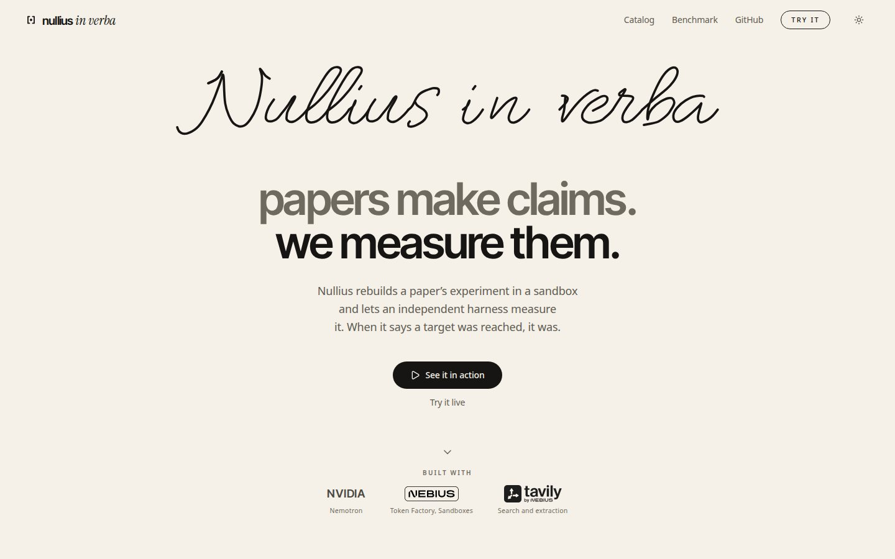
</picture>

<picture>
  <source media="(prefers-color-scheme: dark)" srcset="docs/img/landing-full-dark.jpg">
  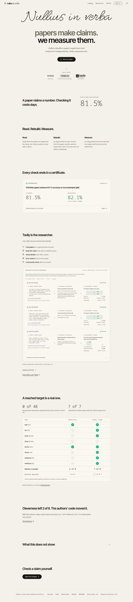
</picture>

<picture>
  <source media="(prefers-color-scheme: dark)" srcset="docs/img/lesson-dark.jpg">
  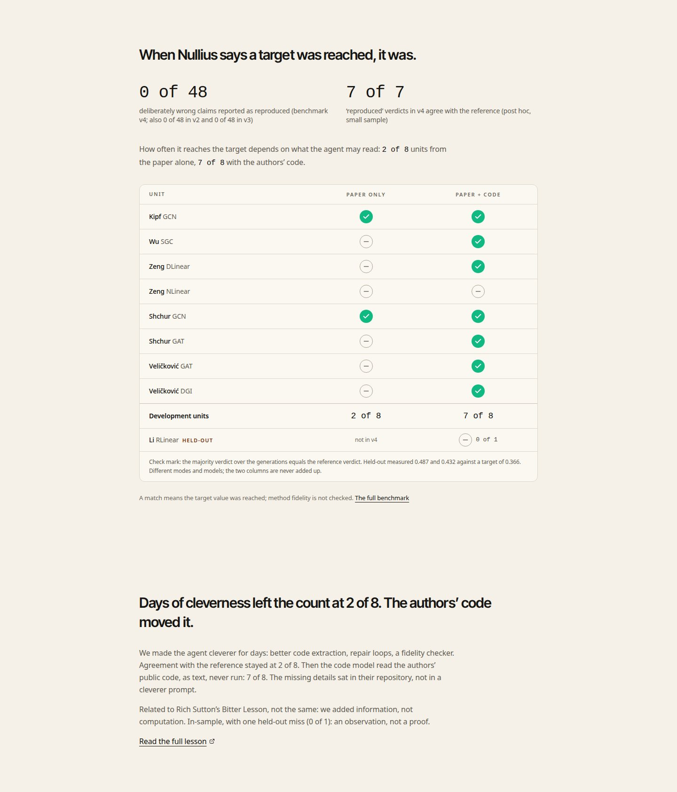
</picture>

**Discover.** Tavily searches the web for new papers on supported benchmarks, reads only the protocol and results sections and keeps claims it can quote word for word. The screenshot is the replay of a recorded run (30 Sep 2026); a live run is limited (one at a time, daily and per-IP limits).

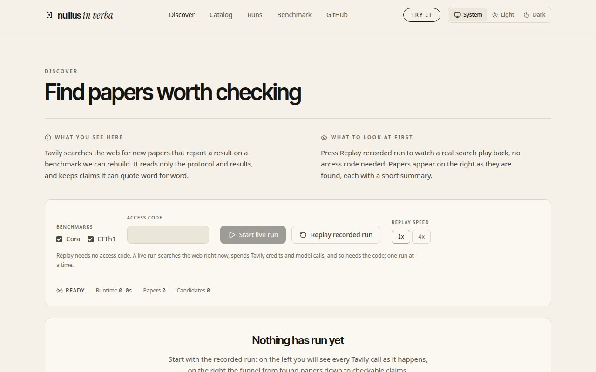

**Catalog.** Candidates that ran once through the full loop, next to the benchmark reference papers. Live runs need no sign-in; they pause when the budget floor is reached, and the UI then shows the recorded run as a replay.

<picture>
  <source media="(prefers-color-scheme: dark)" srcset="docs/img/catalog-dark.jpg">
  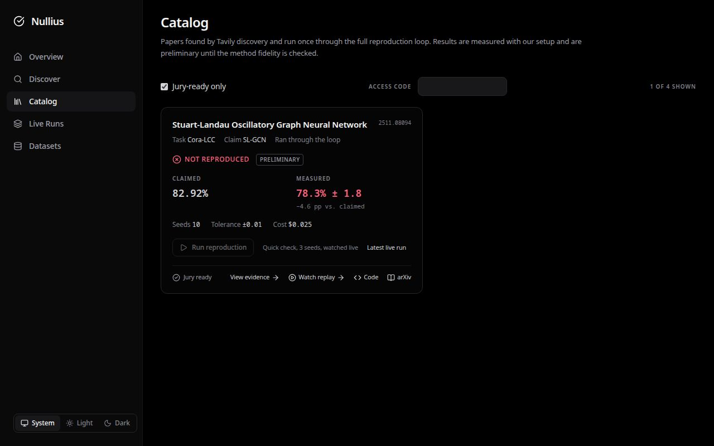
</picture>

**Live run.** A reproduction streams over Server-Sent Events: Tavily findings, plan, code, branches, measurements and repairs as they happen. The nine steps fill in while the run progresses; the header names the mode of the rebuild. Below: a run in progress and the finished one (the screenshots replay a recorded run of 9 Oct 2026 through the live view).

<picture>
  <source media="(prefers-color-scheme: dark)" srcset="docs/img/live-running-dark.jpg">
  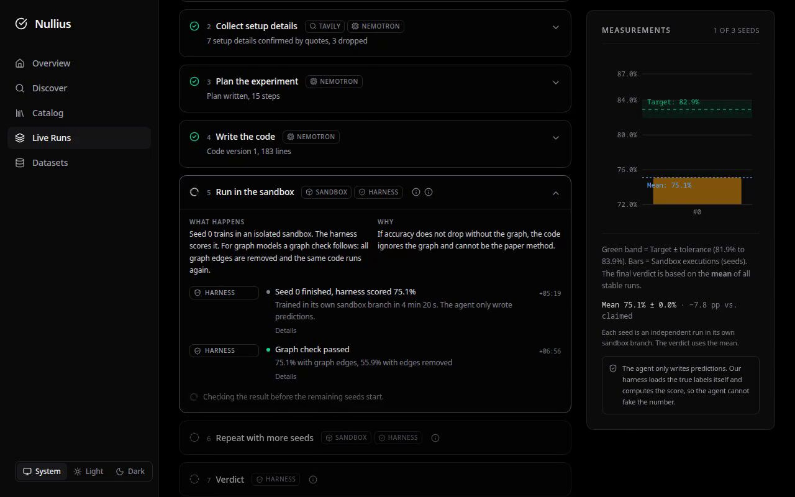
</picture>

<picture>
  <source media="(prefers-color-scheme: dark)" srcset="docs/img/live-finished-dark.jpg">
  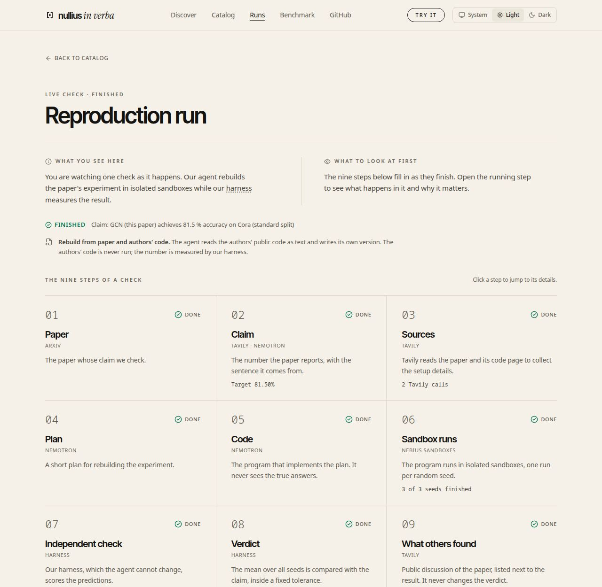
</picture>

**Evidence (the certificate).** The certificate is a page of its own: the claim, the mode ("Rebuild from paper and authors' code: the agent reads the authors' public code as text and writes its own version; the authors' code is never run"), the verdict sentence, measured against claimed with every seed, what Tavily found on the left and what the sandbox measured on the right, branch tree and step-by-step replay. A slider lets you drag the claimed value to see how placebo claims are rejected.

<picture>
  <source media="(prefers-color-scheme: dark)" srcset="docs/img/evidence-dark.jpg">
  
</picture>

**Findings that became experiments.** What Tavily finds is not only reported: a finding that names something we can repeat or change ran in its own sandbox branch, and the harness measured it. Words on the left, experiment in the middle, measurement on the right; discarded findings stay listed. This never changes the verdict. Screenshot: a live DLinear run of 8 Oct 2026 (paper-only mode).

<picture>
  <source media="(prefers-color-scheme: dark)" srcset="docs/img/findings-experiments-dark.jpg">
  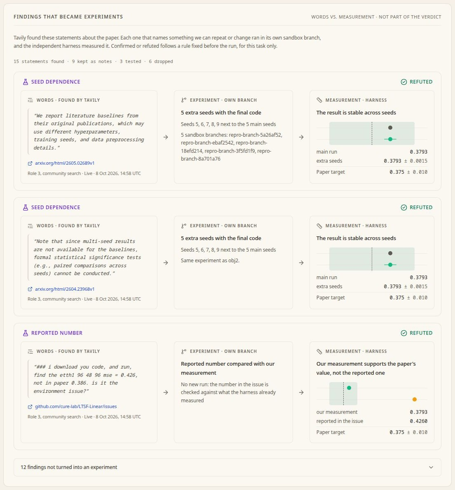
</picture>

**Benchmark.** The same numbers as in this README: the negative control, the precision check and the primary metric of v4, then the table per paper and claim.

<picture>
  <source media="(prefers-color-scheme: dark)" srcset="docs/img/benchmark-dark.jpg">
  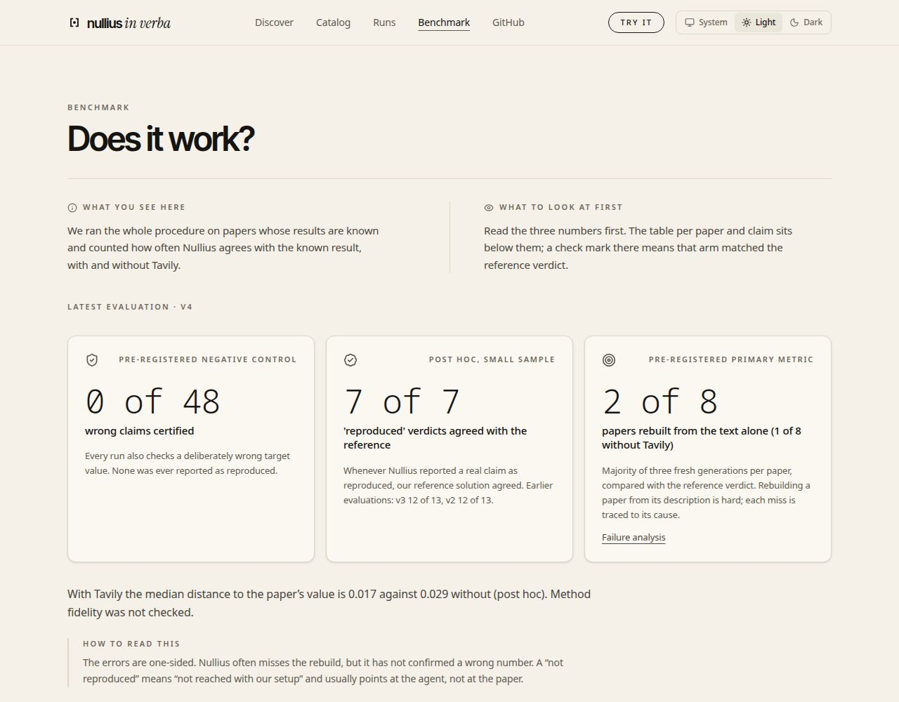
</picture>

## How it works

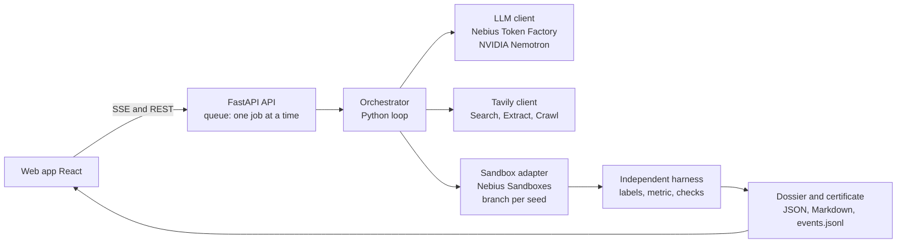

Nemotron is the brain, the sandbox is the lab, Tavily is the researcher, the orchestrator is the lab head. **The model never executes code; the sandbox never thinks.** Per claim: Tavily reads the target value and setup details, Nemotron plans and writes the code, the sandbox runs seed 0 in a branch, the harness scores it, checks run, the code is repaired if needed, then the remaining seeds run in parallel branches with exactly that code. The verdict rests on the **mean over all seeds** against a tolerance fixed before the run.

- **Two rebuild modes.** The default is **"Rebuild from paper and authors' code"** (`nachbau_autorencode`): the agent reads a verbatim excerpt of the authors' public repository (model file, preprocessing, run scripts, configs) and writes its **own** single script from it; a fact sheet enforces the numeric settings. The authors' code is read as text and **never executed**; the number is always measured by our harness. If no repository is found, the clone fails or it holds no code for the model, the run falls back to **"Rebuild from paper"** (`nachbau`: only details quoted from the paper and the README) and the certificate says so. Every certificate names its mode; `author_code=false` (API), `--no-author-code` (CLI, `scripts/curate_catalog.py`) selects the paper-only mode. Benchmark v4 was measured in the paper-only mode; the authors'-code mode is evaluated separately ([above](#our-own-small-bitter-lesson)).
- **Independent harness.** The agent writes `/output/predictions.csv` (`id,prediction`) and nothing else counts. The harness is copied in fresh, loads the test labels itself from the original dataset, checks plausibility and computes the metric with fixed, tested code.
- **Leak protection** (recorded in the dossier under `isolation`): no network in training (`unshare -n`), a static code check rejects network access, downloads, process spawning and dynamic code, test labels never enter the agent's dataset.
- **Two axes.** Axis 1 is the result (reproduced / partially / not reproduced / agent fault suspected / not reproducible with our setup). Axis 2 is method fidelity (yes / partially / no / not checked) and is **"not checked"** in the benchmark (see Limits).
- **Checks and repairs.** Smoke run on a tiny subset, trivial baselines (a result below the best one is flagged "agent fault suspected", not blamed on the paper), a graph ablation for graph models (code run again without edges; validation 9/10, [`results/ablation_gcn_validation.md`](benchmark/experiments/results/ablation_gcn_validation.md)), crash repair from the end of stderr, a plan validator, a deterministic table-column check. At most `MAX_ATTEMPTS_PER_CLAIM` attempts, then "not reproducible with our setup" with the documented attempts.

## How we use NVIDIA Nemotron

Every reasoning and coding step is a call to an NVIDIA Nemotron model through one OpenAI-compatible endpoint (`src/repro_agent/llm.py`).

| Role | What it does | Model in production |
|---|---|---|
| `fast` | table and target-value extraction from paper text | Nemotron 3.5 Lightning (`nvidia/Nemotron-3_5-Lightning`) |
| `code` | writes and repairs the experiment script | Nemotron 3 Super 120B-A12B (`nvidia/nemotron-3-super-120b-a12b`) |
| `extract` | setup details with verbatim quotes from paper, README and repository files (same model as `code`) | Nemotron 3 Super |
| `reasoning` | research plan | Nemotron 3 Super 120B-A12B (`nvidia/nemotron-3-super-120b-a12b`), same model as `code` |

Nemotron plans and writes code; it never runs it. The sandbox runs it, the harness measures it. Every quote a model returns is re-checked against the source text and dropped if it does not occur there. Model IDs and routing are environment variables (`.env.example`).

**Note on Ultra.** Plan and verdict ran on Nemotron 3 Ultra 550B-A55B until 2026-10-09. Token Factory removed that model on 2026-10-09 (about 01:52 UTC; it is no longer listed and `chat/completions` returns HTTP 404), so `reasoning` now runs on Super. The benchmark v2 to v4 runs used Ultra for `reasoning`; the recall runs (cg v1) and the G0/G1 gates used Super for every role. Results are reported per model as run; none was re-run.

## Where Nebius Token Factory helped

Stated only where the repository shows it:

- **One endpoint for every role.** Lightning, Super (and, until 2026-10-09, Ultra) sit behind the same OpenAI-compatible API, so switching provider is an environment change; provider-specific code lives only in the LLM client.
- **Usage you can reconcile.** Token counts from the API's `usage` field agreed with the console within its rounding (net 1.256 $ in our log vs 1.26 $ in the console on 29 Sep 2026; [`docs/research_log.md`](docs/research_log.md), "Cost tracking").
- **Cost control that worked.** Per-run limit, global budget with a cut-off (warning at 80 %, abort at 95 % before the call), retries with back-off, hard stop on billing or authentication errors.
- **Low cost per paper.** Catalog runs, gross incl. VAT (30 Sep 2026): SL-GCN on Cora-LCC 0.028 $ and 0.025 $ (10 seeds each), MoHETS on ETTh1 0.093 $ (3 seeds), from the `run_end` events in `web/public/data/disc_*/*/events.jsonl` (model cost only, Tavily excluded). The whole v4 benchmark (48 runs) cost 7.78 $ gross; the authors'-code run (22 counted runs) 5.49 $.

Feedback on Token Factory, the sandboxes and the NVIDIA models: [`docs/nebius_feedback.md`](docs/nebius_feedback.md).

## Other Nebius services: Sandboxes

All experiment code runs in **Nebius Sandboxes** (`contree-sdk`).

- **Real branching:** the base image (Python, numpy, scipy, torch) is built once as a snapshot; every seed, repair attempt, graph ablation and objection experiment is a branch of it. A failed attempt is rolled back for free.
- **Parallel seeds:** 20 parallel branches from one snapshot ran without errors in our test (higher was not tested).
- **Isolation:** the agent's training run has no network (`unshare -n`); the harness is copied in fresh afterwards.

## How we use Tavily

A normal run calls Tavily **live** at run time (`TAVILY_MODE=live`, the default). Every source is recorded with mode, timestamp, SHA-256 and length in the dossier, in `events.jsonl` and as `paper_text.json`, so a run stays traceable if a web page changes. The live and evidence views show a badge per Tavily call.

| Where | Endpoint | Purpose |
|---|---|---|
| **Discovery (live catalog)** | Search (github.com, arxiv.org, openreview.net) | finds new papers on supported benchmarks, reads protocol and results sections |
| Read claims (role 2) | arXiv API (Tavily as fallback) | LaTeX source is downloaded directly via arXiv API to extract tables with target values. Checked by quote and table column. |
| Material and setup details (roles 1, 4) | Search for the repository, Extract on the README, sandbox clone of chosen files | hyperparameters and data splits, each with a quote from paper, README or repository |
| Error search (role 5) | Search with the failing line | solution hint for the code repair |
| Community check (roles 3, 6) | Search, limited Crawl of repository issues | after the verdict: "What others found" and "Possible explanations", each with a quote. Verified findings that can be repeated become sandbox experiments (below). **Never changes the verdict** (`src/repro_agent/community.py`, `objection_experiments.py`) |

**Tavily findings that became experiments.** In a live DLinear run (8 Oct 2026, paper-only mode) Tavily's community search returned statements about the paper, for example that literature baselines in other papers may use different seeds and preprocessing, and a GitHub issue reporting an MSE of 0.426 against 0.386. Each statement that could be repeated ran as its own sandbox branch and was measured by the harness: five extra seeds gave 0.3793 ± 0.0015 ("seed dependence refuted"), and the issue's 0.426 was compared with our own 0.3793 (our measurement supports the paper's value, not the reported one). See the "Findings that became experiments" screenshot above and [`results/tavily_experiments_addendum_b.md`](benchmark/experiments/results/tavily_experiments_addendum_b.md).

**A find we hoped for, and did not get.** For ETTh1 the harness can also re-score the same predictions with the last incomplete test batch dropped, as LTSF-style data loaders do (`drop_last=True`, batch size 128): all 2785 test windows **0.3793**, the last 97 skipped **0.3754**, paper **0.375**. The verdict still uses all windows. That note and its sources are a fixed list in the code, written from our own manual web research; **it is not a Tavily result.** We tried to let Tavily find the notice and turn it into this experiment by itself (pre-registered, three live runs, addenda A to C): the search did not return a page that names it, so the automatic path never ran live. It works on stored predictions and in tests. Findings become experiments when the search returns a measurable statement, not on demand.

<picture>
  <source media="(prefers-color-scheme: dark)" srcset="docs/img/droplast-dark.jpg">
  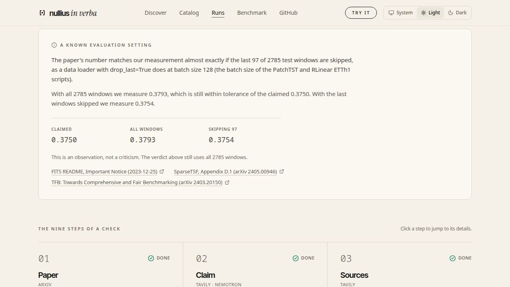
</picture>

Tavily's effect on the benchmark is small (see below); its main role in the product is Discovery, the traceable sources and findings that turn into measurements. The Tavily key is scarce, so tests and the benchmark use stored copies (`--offline`, `TAVILY_MODE=fixture`; in v4 only role 5 was live, in the authors'-code run none).

**Not built:** Tavily Research for citable sources (role 7), possible explanations of a deviation as their own hypotheses (role 6), and the "re-run" mode that executes the authors' code.

## What Nullius found: SL-GCN on Cora

A catalog check of a recent paper, one of the first claims Nullius ran on a Discovery find. Not reproduced with our setup; this says nothing yet about the paper.

- **Claim:** Stuart-Landau Oscillatory GNN (arXiv 2511.08094) reports SL-GCN at **82.92 ± 1.39 %** on Cora with Shchur-style random splits (Table 2, arXiv v2; `benchmark/catalog.yaml`, entry `disc_2511_08094`). The paper averages over 100 splits and initialisations.
- **Measured:** **0.783 ± 0.018** accuracy (mean ± std over 10 seeds), against target 0.8292 with tolerance ±0.01, so the gap (0.046) is more than 3 × tolerance: verdict "not reproduced" (`web/public/data/disc_2511_08094/20260930-200050/zeugnis.md`, `dossier.json`).
- **Effort:** 1 generated program, 10 of 10 seeds valid, 0 repairs, 0.025 $ gross (`catalog.yaml`; `events.jsonl`, `run_end`). The graph ablation shows the code uses the graph (0.751 with edges, 0.559 without, seed 0).
- **Evidence:** [run page](web/public/data/disc_2511_08094/20260930-200050/zeugnis.md); in the web app `#/run/disc_2511_08094--20260930-200050` (target quote with SHA-256, plan, code, branch tree, replay).
- **Read with care:** this run used the paper-only mode, in which Nullius matched the reference verdict on only 2 of 8 benchmark units, so a miss can be a weakness of our agent, not of the paper. The first run on this claim (`20260930-194446`, same folder) measured 0.552 and was flagged "method not implemented". Method fidelity is not checked (overall statement: provisional). We use 10 seeds instead of 100 splits. We did not contact the authors and make no claim about them.

## Benchmark

**Scope: small graph and time-series models that run on CPU in minutes.** Six papers, eight paper-claim units, each with and without Tavily, three fresh generations per unit and arm, plus a deliberately wrong **placebo** claim per run (for example 88 % on Cora). 48 runs, product configuration of that time (paper-only mode), stored Tavily results in both arms. Rules fixed before the first run ([`benchmark_v2.md`](benchmark/experiments/benchmark_v2.md), v4 changes in [`benchmark_v4.md`](benchmark/experiments/benchmark_v4.md)); results in [`results/benchmark_v4.md`](benchmark/experiments/results/benchmark_v4.md), code `bf520c1` and `2b13b31`, numbers exported by `scripts/export_benchmark_json.py` (also shown on the Benchmark page of the web app).

**1. Precision first.** No placebo was ever reported as "reproduced": 0 of 48 in v4 and, with different code, 0 of 48 in each of v2 and v3. All 16 placebo majorities in v4 say "not reproduced". Every "reproduced" verdict for a real claim in v4 (7 of 7) matched our reference solution (post hoc, small sample).

**2. Primary metric** (pre-registered): per unit, the majority verdict of three generations against the reference verdict. With Tavily **2 of 8** units agree (Kipf-GCN, Shchur-GCN), without Tavily **1 of 8** (DLinear). The pre-registered expectation for v4 (more agreement than v3 in at least one arm) was **not met**.

**3. How to read it.** The errors are one-sided: Nullius often misses the rebuild but has not confirmed a wrong number. A miss means "not reached with our setup" and usually points at the agent, not at the paper. Misses are mostly consistent near misses: the median distance to the target value is 0.017 with and 0.029 without Tavily (post hoc), "partially" is the most frequent miss. What improved from v2 to v4 is stability (no unit without a majority) and failures (1 of 48 real-claim verdicts without a measurement). Tavily makes no measurable difference at this sample size (2 vs 1 of 8).

| Unit (task) | Reference verdict (source) | Majority without Tavily | Majority with Tavily | Placebo detected (both arms) |
|---|---|---|---|---|
| Kipf & Welling 2017, GCN (Cora) | reproduced (R) | not reproduced | **reproduced** | yes |
| Wu et al. 2019, SGC (Cora) | reproduced (R) | partially | not reproduced | yes |
| Zeng et al. 2023, DLinear (ETTh1) | reproduced (R) | **reproduced** | partially | yes |
| Zeng et al. 2023, NLinear (ETTh1) | reproduced (R) | not reproduced | not reproduced | yes |
| Shchur et al. 2018, GCN, random splits (Cora) | reproduced (R, H) | partially | **reproduced** | yes |
| Shchur et al. 2018, GAT, random splits (Cora) | reproduced (R, H) | partially | partially | yes |
| Veličković et al. 2018, GAT (Cora) | reproduced (R) | partially | partially | yes |
| Veličković et al. 2019, DGI (Cora) | partially (R) | not reproduced | not reproduced | yes |
| **Units agreeing with the reference** | | **1 of 8** | **2 of 8** | **8 of 8 / 8 of 8** |

| | v2 | v3 | v4 |
|---|---|---|---|
| Units agreeing with the reference, without / with Tavily | 2 / 2 of 8 | 2 / 2 of 8 | 1 / 2 of 8 |
| Placebo verdicts "reproduced", of 48 | 0 | 0 | 0 |
| Placebo majorities "not reproduced", of 16 | 13 | 14 | 16 |

Each version ran different code; v2 and v3 in full: [`docs/benchmark_history.md`](docs/benchmark_history.md). Every v4 miss is traced to its cause in [`failure_analysis_v4.md`](benchmark/experiments/failure_analysis_v4.md) and [`results/failure_log_v4.md`](benchmark/experiments/results/failure_log_v4.md). One v4 process died on a sandbox connection error and was restarted with unchanged code ([`benchmark_v4_incidents.md`](benchmark/experiments/results/benchmark_v4_incidents.md)). The authors'-code run (recall cg v1) is a separate, smaller measurement with its own rules; its per-unit table is in [Our own small bitter lesson](#our-own-small-bitter-lesson).

**Limits, stated up front.**
- **Method fidelity is not checked.** The LLM checker failed its pre-registered threshold in three calibrations (5/10, 7/10, 8/11; [`calibration_fidelity_v1.md`](benchmark/experiments/results/calibration_fidelity_v1.md), `_v2.md`, `_v3.md`). Axis 2 stays "not checked", every verdict is provisional, and the benchmark counts axis 1: "target value reached according to the harness". Only the graph ablation says something about method use, for graph models.
- **No real negative case.** Dacrema et al. (2019) was dropped (on MovieLens-1M the paper itself reproduces NeuMF) and Shwartz-Ziv & Armon was scoped and dropped ([`shwartz_ziv_scoping.md`](benchmark/experiments/shwartz_ziv_scoping.md)). The placebo claims are constructed and do not replace a real negative case.
- **Reference verdicts.** (R) = our own reference solution run through the same harness, so not independent of our protocol choices; (H) = independent re-measurement in a critique paper (Shchur et al., GCN and GAT).
- **Small numbers.** Eight units are counts, not a significance test. Both arms get the same target value, so a difference comes from setup details and prompt length.
- Three datasets, CPU only; DGI was meant as a Tavily holdout and is no longer clean ([`tavily_v2_holdout.md`](benchmark/experiments/tavily_v2_holdout.md)).

All numbers in this README and in the video come from production runs on Token Factory.

## Related work

- **PaperBench** ([Starace et al., 2025](https://arxiv.org/abs/2504.01848)): agents replicate 20 ICML 2024 Spotlight and Oral papers from scratch, graded against hierarchical rubrics (8,316 gradable sub-tasks) co-developed with the authors, using an LLM judge.
- **CORE-Bench** ([Siegel et al., 2024](https://arxiv.org/abs/2409.11363)): 270 tasks from 90 papers; agents run the code and data supplied with a paper and answer questions about the results.
- **Difference.** Nullius is judged against the *paper's own claim*, not a rubric. The number comes from an independent harness the agent cannot touch, and a verdict can say "not reproduced". Claims run on CPU in minutes, so a check costs cents and can be watched live. We test our own components with rules fixed beforehand and report the failures.

## Setup and usage

Requirements: Python 3.11+, [uv](https://docs.astral.sh/uv/), Node 22 for the web app, a Nebius Token Factory key, a Nebius Sandboxes project and a Tavily key.

```bash
cp .env.example .env                 # add NEBIUS_API_KEY, NEBIUS_PROJECT_ID, TAVILY_API_KEY, set LLM_PROVIDER=tokenfactory
uv sync

# one paper, all its claims (benchmark/papers.yaml)
LLM_PROVIDER=tokenfactory uv run repro-agent kipf_gcn_2017
#   --no-tavily  no Tavily at all   --offline  stored Tavily results   --fresh  no LLM cache
#   --no-author-code  paper-only rebuild instead of the default authors'-code mode

# web app (development) and API (live runs, SSE)
cd web && npm ci && npm run dev
uv run uvicorn repro_agent.api:app --port 8000

# tests (no network, no cost)
uv run python -m pytest -m "not integration"
cd web && npm run build && npm run lint && npm test
```

Configuration lives in `.env` (`LLM_PROVIDER`, `SANDBOX_BACKEND`, budgets, VAT rate, `TAVILY_MODE`). Runs are written to `runs/<paper>/<timestamp>/`; `scripts/export_site_data.py` copies selected runs to `web/public/data` (publish only production runs). The API needs no access code. It limits live runs to one at a time, per day and per IP, pauses them when the remaining model budget or Tavily credits fall below a floor (`LIVE_MIN_BUDGET_USD`, `LIVE_MIN_TAVILY_CREDITS`; status at `GET /api/status`), and keeps all keys on the server. `Dockerfile` builds API and web app into one container; hosting steps are in [`docs/deploy.md`](docs/deploy.md).

## Limitations and roadmap

- CPU only, claims under ten minutes; no LLM papers, no PDF image analysis. Each new dataset needs a task and a harness once.
- Two rebuild modes (see "How it works"): in both the agent writes its own code. Reading the authors' code is the default; running it ("re-run") tests something different and is not part of the product.
- The authors'-code result is in-sample with one held-out miss; a fresh set of held-out papers is the next honest test.
- The graph ablation covers graph models only; DLinear and NLinear would need a decomposition or normalisation ablation.
- **Roadmap:** a method-fidelity checker that passes calibration; more tasks and datasets; findings from the community check turned into experiments on every run, not only when search returns the right page; a real negative case; notifying paper authors with the certificate ([`docs/idea_author_notification.md`](docs/idea_author_notification.md)).

## Licence

MIT, see [`LICENSE`](LICENSE).

Datasets are not redistributed; the harness downloads them from their sources at run time. The `kimiyoung/planetoid` repository (Cora, CiteSeer, PubMed raw files) carries an MIT `LICENSE` (Copyright 2016 Zhilin Yang); the `zhouhaoyi/ETDataset` repository (ETT files) carries a `LICENSE` file with Creative Commons Attribution-NoDerivatives 4.0 International. Both checked on 7 Oct 2026 by reading the files in those repositories; we did not check licences of other sources.
