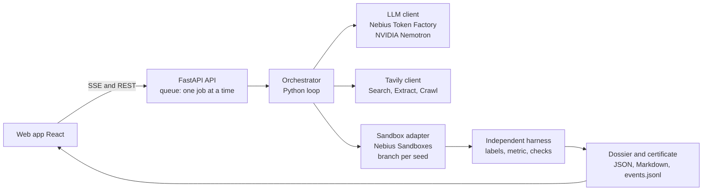

# Nullius

**Other agents fix code until the tests pass. Here, the paper is the test suite.**

*Nullius in verba* ("take nobody's word for it"): Nullius takes a claim from a machine-learning paper, rebuilds the experiment in an isolated sandbox and lets an independent harness measure the result. The verdict is a measurement, not an opinion.

Built for the Nebius x NVIDIA Global AI Hackathon (track: Coding and Agentic Engineering, plus Best Use of Tavily). Licence: MIT. Repository: <https://github.com/Script-hpp/Nullius>

**Status:** feature-complete prototype. Benchmark numbers come from production runs on Nebius Token Factory (section "Benchmark"). Every statement points to a file in this repository.


## Contents

[Problem](#problem-and-audience) | [Product tour](#product-tour) | [How it works](#how-it-works) | [NVIDIA Nemotron](#how-we-use-nvidia-nemotron) | [Token Factory](#where-nebius-token-factory-helped) | [Nebius Sandboxes](#other-nebius-services-sandboxes) | [Tavily](#how-we-use-tavily) | [Benchmark](#benchmark) | [Related work](#related-work) | [Setup](#setup-and-usage) | [Limitations](#limitations-and-roadmap)

## Problem and audience

Many machine-learning results are hard to reproduce. Rebuilding a paper costs days of broken code, missing hyperparameters and numbers that do not come out. Whether a claim holds is usually known only after someone has paid that price.

Nullius is for **reviewers** who want a quick check of a headline number, **PhD students** who want to build on a paper, and **ML teams** that depend on published results.

Give it a paper (an arXiv link or an entry of the catalog). It

1. extracts checkable claims with target values (Tavily Extract on the paper text; every number is quoted verbatim and re-checked against the text and the table header),
2. collects setup details from the paper, the README and the repository,
3. writes its own experiment code and runs it in sandbox branches, one branch per seed,
4. lets an **independent harness** score the predictions, and
5. issues a certificate: a verdict per claim with measured mean, spread, sources and the branch tree as evidence.

The agent delivers *predictions*, never numbers. Verdicts are worded carefully ("not reproduced *with our setup*") and always list the attempts.

**Honest scope:** Nullius checks papers that evaluate on benchmarks it already supports (today Cora, Cora with random splits, and ETTh1). A new dataset needs a one-time task and harness; new papers on existing datasets work out of the box. CPU only, claims that run in minutes.

## Product tour

| | |
|---|---|
| **Discover.** Tavily searches the web for new papers on supported benchmarks, reads only the protocol and results sections and proposes checkable claims, each with a verbatim quote.  | **Catalog.** Candidates that ran once through the full loop, with claimed and measured value, seeds, tolerance and cost. A live run needs an access code (one run at a time, daily limits).  |

**Live run.** A reproduction streams over Server-Sent Events: Tavily findings, plan, code, sandbox branches, measurements and repairs appear as they happen. The two screenshots are from a real live run in the UI (Nebius Sandbox, SL-GCN, quick check with 3 seeds; LLM answers were served from the cache in this recording).


**Evidence.** The certificate is a page of its own: Tavily's findings and the verified target value on the left, what the sandbox measured on the right, the branch tree with repairs and a step-by-step replay of the event log. If a live run cannot start, the UI says so and offers the last finished run as a replay.


The web app is a static React app (`web/`); the live controls appear only when the API is reachable.

## How it works



Nemotron is the brain, the sandbox is the lab, Tavily is the researcher and the orchestrator is the lab head. **The model never executes code; the sandbox never thinks.**

The loop per claim: Tavily reads the target value and setup details, Nemotron plans and writes the code, the sandbox runs seed 0 in a branch, the harness scores it, checks run, the code is repaired if needed, then the remaining seeds run in parallel branches with exactly that code. A verdict rests on the **mean over all seeds** against a tolerance fixed before the run.

**Independent harness.** The agent writes `/output/predictions.csv` (`id,prediction`); nothing else counts. After the agent's run, the harness is copied fresh into the branch, loads the test labels itself from the original dataset, checks plausibility (complete unique ids, not a single class) and computes the metric with fixed, tested code.

**Leak protection** (recorded in the dossier under `isolation`): the training run has no network (`unshare -n`); a static code check rejects network access, downloads, process spawning and dynamic code; test labels never enter the agent's dataset.

**Two axes.** A verdict is not one number:

| Axis | Values | Source |
|---|---|---|
| 1. Result | reproduced / partially / not reproduced / agent fault suspected / not reproducible (setup) | mean over all seeds against a tolerance fixed before the run |
| 2. Method fidelity | yes / partially / no / not checked | method checklist, graph ablation |

Axis 2 is **"not checked"** in the benchmark (see [Limitations](#limitations-and-roadmap)); a "reproduced" therefore means "target value reached", not "method reproduced".

**Checks and repair loops.**
- **Form check:** the script first runs with `SMOKE=1` on a tiny subset; the output form is compared with the task's contract, so tensor-shape errors surface within seconds.
- **Baselines:** the harness reports trivial baselines (majority class, no-graph logistic regression, repeat-last-value). A result below the best trivial baseline is flagged "agent fault suspected" instead of blaming the paper.
- **Graph ablation (graph models):** the code runs a second time without edges. If accuracy does not drop, the graph was never used, however the code looks (rule fixed in advance: drop >= 0.10 "graph used", <= 0.02 "graph not used"). [`benchmark/experiments/ablation_gcn.md`, validation 9/10 in `results/ablation_gcn_validation.md`]
- **Repair loops:** a crash is repaired from the end of stderr (no baseline numbers in the prompt); a plan validator rejects plans that are code; if the ablation says "graph not used" the code is repaired; overall at most three rounds and at most `MAX_ATTEMPTS_PER_CLAIM` attempts, then the verdict is "not reproducible with our setup" with the documented attempts.
- **Column check:** the table header is parsed deterministically and the position of the target number in the row is compared with the position the header dictates.

## How we use NVIDIA Nemotron

Every reasoning and coding step is a call to an NVIDIA Nemotron model through one OpenAI-compatible endpoint (`src/repro_agent/llm.py`).

| Role | What it does | Model in production |
|---|---|---|
| `fast` | table and target-value extraction from paper text | Nemotron 3.5 Lightning (`nvidia/Nemotron-3_5-Lightning`) |
| `code` | writes and repairs the experiment script | Nemotron 3 Super 120B-A12B (`nvidia/nemotron-3-super-120b-a12b`) |
| `extract` | setup details with verbatim quotes from paper, README and repository files (same model as `code`) | Nemotron 3 Super |
| `reasoning` | research plan | Nemotron 3 Ultra 550B-A55B (`nvidia/Nemotron-3-Ultra-550b-a55b`) |

Nemotron plans and writes code; it never runs it. The sandbox runs it, the harness measures it. Every quote a model returns is re-checked against the source text and dropped if it does not occur there. Model IDs and routing are set by environment variables (`.env.example`).

## Where Nebius Token Factory helped

Stated only where the repository shows it:

- **One endpoint for every role.** Lightning, Super and Ultra sit behind the same OpenAI-compatible API, so switching provider is an environment change; the only provider-specific code is in the LLM client.
- **Usage you can reconcile.** Token counts from the API's `usage` field agreed with the console within its rounding (net 1.256 $ in our log vs 1.26 $ in the console on 29 Sep 2026); details in [`docs/research_log.md`](docs/research_log.md) (section "Cost tracking").
- **Cost control that worked in practice.** A per-run limit, a global budget with a cut-off date (warning at 80 %, abort at 95 % before the first call), retries with back-off and a hard stop on billing or authentication errors.
- **Low cost per paper.** Catalog runs on Token Factory, gross incl. VAT (30 Sep 2026): SL-GCN on Cora-LCC 0.028 $ and 0.025 $ (10 seeds each), MoHETS on ETTh1 0.093 $ (3 seeds), from the `run_end` events in `web/public/data/disc_*/*/events.jsonl` (model cost only, Tavily excluded).
- **Speed compared with the free OpenRouter endpoints used for prototyping:** `TBD` (no measured comparison in the repository yet; will be added only with data from `logs/costs.jsonl`).

Feedback on Token Factory, the sandboxes and the NVIDIA models: [`docs/nebius_feedback.md`](docs/nebius_feedback.md).

## Other Nebius services: Sandboxes

All experiment code runs in **Nebius Sandboxes** (`contree-sdk`), the lab of this project.

- **Real branching:** the base image (Python, numpy, scipy, torch) is built once as a snapshot; every seed, every repair attempt and every graph ablation is a branch of that snapshot. A failed attempt is rolled back for free.
- **Parallel seeds:** 20 parallel branches from one snapshot ran without errors in our test (higher was not tested).
- **Isolation:** the agent's training run executes with `unshare -n` (no network); the harness is copied in fresh afterwards.

Deployment on a Nebius Compute VM is documented as an alternative in [`docs/deploy.md`](docs/deploy.md); whether the live demo runs on it: `TBD`.

## How we use Tavily

A normal run calls Tavily **live** at run time (`TAVILY_MODE=live`, the default):

| Role | Endpoint | Purpose |
|---|---|---|
| Discover papers | Search (github.com, arxiv.org, openreview.net), Extract | find new papers on supported benchmarks, code and community reports |
| Read claims | Extract on the arXiv text | tables with target values, verified by quote and column check |
| Setup details | Extract on the repository README, Sandbox clone of chosen files | hyperparameters and data splits, each with a verbatim quote from paper, README or repository |

Every source is recorded with mode (`live` or stored copy), timestamp, SHA-256 and length in the dossier (`sources`), in `events.jsonl` and as `paper_text.json` in the run folder, so a run stays traceable even if the web page changes. The live view and the evidence view show a badge per Tavily call. Every call must answer a question the agent could not answer otherwise; the Tavily key is scarce, so tests use stored copies (`--offline`, `TAVILY_MODE=fixture`) and the paper text is cached per run.

Not built: objection search and crawl in the loop, error-message search and deviation explanations (roles 3, 5, 6, 7 of the original plan). Stage 1 of objection search was tried as an experiment ([`docs/research_log.md`](docs/research_log.md)).

## Benchmark

**Scope: small graph and time-series models that run on CPU in minutes.** A narrow, well-documented benchmark proves more than a broad one with shaky tasks.

**Method (fixed before the first run: [`benchmark/experiments/benchmark_v2.md`](benchmark/experiments/benchmark_v2.md)).**
- Six papers, eight paper-claim units; each unit runs **with** and **without** Tavily (role 2 target value and role 4 setup details; without: no Tavily at all). In the benchmark both arms use stored Tavily results, so every generation sees the same text; the live call is shown in the product runs.
- Three fresh generations per unit and arm, each with the real claim and a **placebo** claim (deliberately wrong target value, for example 88 % on Cora).
- Product configuration (plan check, fault repair, graph repair) in both arms.
- **Counting:** per unit the *majority* of the three generations (at least two equal classes); a unit agrees if the majority equals the reference verdict. "No majority", failures and incomplete units never count as agreement. Raw counts of single verdicts are reported as a secondary number. Placebos are counted separately.
- Tolerance and seeds per paper are fixed in `benchmark/papers.yaml` and the pre-registration; evaluation script: `scripts/eval_benchmark_v2.py`.

**The latest evaluation (v4) in three numbers** (computed by `scripts/export_benchmark_json.py` from the run store, shown on the Benchmark page of the web app):
- **0 of 48 wrong claims certified** (pre-registered negative control): every run also checks a deliberately wrong target value, and none was ever reported as reproduced (also 0 of 48 in v2 and v3).
- **7 of 7 "reproduced" verdicts agreed with the reference** (post hoc, small sample): whenever Nullius reported a real claim as reproduced in v4, our reference solution agreed. In v2 and v3 it was 12 of 13 each.
- **2 of 8 papers rebuilt from the text alone, 1 of 8 without Tavily** (pre-registered primary metric): majority of three fresh generations per paper against the reference verdict. Rebuilding a paper from its description is hard; each miss is traced to its cause ([`failure_analysis_v4.md`](benchmark/experiments/failure_analysis_v4.md)). With Tavily the median distance to the paper's value is 0.017 against 0.029 without (post hoc). Method fidelity was not checked.

**How to read this.** The errors are one-sided: Nullius often misses the rebuild, but it has not confirmed a wrong number. A "not reproduced" means "not reached with our setup" and usually points at the agent, not at the paper.


| Unit (task) | Reference verdict (source) | Majority without Tavily | Majority with Tavily | Placebo detected without / with |
|---|---|---|---|---|
| Kipf & Welling 2017, GCN (Cora) | reproduced (R) | no majority | reproduced | failure / yes |
| Wu et al. 2019, SGC (Cora) | reproduced (R) | reproduced | partially | yes / yes |
| Zeng et al. 2023, DLinear (ETTh1) | reproduced (R) | reproduced | reproduced | yes / yes |
| Zeng et al. 2023, NLinear (ETTh1) | reproduced (R) | no majority | no majority | yes / yes |
| Shchur et al. 2018, GCN, random splits (Cora) | reproduced (R, H) | partially | no majority | yes / yes |
| Shchur et al. 2018, GAT, random splits (Cora) | reproduced (R, H) | failure (setup) | no majority | failure / yes |
| Veličković et al. 2018, GAT (Cora) | reproduced (R) | not reproduced | no majority | yes / yes |
| Veličković et al. 2019, DGI (Cora) | partially (R) | not reproduced | failure (setup) | yes / failure |
| **Units agreeing with the reference verdict** | | **2 of 8** | **2 of 8** | **6 of 8 / 7 of 8** |

**Result** (all 48 runs, code `d71a8af`, [`benchmark/experiments/results/benchmark_v2.md`](benchmark/experiments/results/benchmark_v2.md)): with Tavily, 2 of 8 paper-claim units matched the reference verdict, without Tavily 2 of 8. **Method fidelity was not checked.**

What the numbers say:
- **Agreement is low, and Tavily makes no measurable difference** at this sample size. Many misses are near misses rather than wrong numbers: the median distance to the target value over valid generations is 0.017 without and 0.011 with Tavily (post hoc, n = 20 each), against tolerances of 0.01; "partially" (within three times the tolerance) is about as frequent as "reproduced" among single verdicts (14 vs 13 of 48). In 6 of 16 unit-arm pairs the three generations disagree ("no majority"), so stability, not only the value, limits agreement.
- **Failures of the agent are common:** 5 of 24 real-claim verdicts without and 6 of 24 with Tavily are failures ("not reproducible (setup)": code never ran within the attempt limit; "agent fault suspected": result worse than a trivial baseline). Example: in one Shchur-GAT run the repair answer of the model contained no code, so the loop stopped after one attempt.
- **No placebo passed.** None of the 48 placebo verdicts (deliberately wrong target value) was "reproduced"; one was "partially". Units where the placebo majority was a failure count as not detected.
- Cost of the whole benchmark: 1.04 $ gross without, 2.56 $ with Tavily (model cost only).

**Benchmark v3** (all 48 runs, code `4bab96e`, pre-registered in [`benchmark/experiments/benchmark_v3.md`](benchmark/experiments/benchmark_v3.md), results in [`results/benchmark_v3.md`](benchmark/experiments/results/benchmark_v3.md)): after a failure analysis of v2 we added fixes for code extraction, repair after timeouts, Tavily error search (role 5), repository search (role 1), following local imports and extracting implementation details. Agreement stayed at **2 of 8 units in both arms**; the units that agree changed (with Tavily, Kipf-GCN and NLinear now agree in all or most generations, SGC got worse because repository defaults replaced the tuned value). Failures of real claims with Tavily fell from 6 to 3 of 24, and single "reproduced" verdicts rose from 7 to 8. **No placebo was ever "reproduced"** (0 of 48 in v3, 0 of 48 in v2). Every miss is listed with its cause in [`results/failure_log_v3.md`](benchmark/experiments/results/failure_log_v3.md) and [`failure_patterns_v3.md`](benchmark/experiments/failure_patterns_v3.md). Method fidelity was not checked.

**Benchmark v4** (all 48 runs, code `bf520c1`, pre-registered in [`benchmark/experiments/benchmark_v4.md`](benchmark/experiments/benchmark_v4.md), results in [`results/benchmark_v4.md`](benchmark/experiments/results/benchmark_v4.md)): after the v3 failure patterns we added three code candidates per claim, chosen only by a validation metric that our harness computes from its own validation labels (test values and the paper's target never enter the choice), checks for prediction-to-node mapping and forbidden libraries, marked repository defaults, and a comparison with the original code (with Tavily only). **Our pre-registered expectation (more agreement than v3 in at least one arm) was not met:** with Tavily 2 of 8 units agree (Kipf-GCN and Shchur-GCN), without Tavily 1 of 8 (DLinear). What changed is stability: no unit is left without a majority (v3: 4 unit-arm pairs), only 1 of 48 real-claim verdicts is a failure (v3: 9), and **all 16 placebo majorities say "not reproduced"** (v3: 14 of 16, v2: 13 of 16). Most misses are now consistent near misses ("partially"; median distance to the target 0.017 with and 0.029 without Tavily, post hoc). The validation choice picked a candidate other than the first in 54 of 96 claims. One process died on a sandbox connection error and was restarted with unchanged code ([`results/benchmark_v4_incidents.md`](benchmark/experiments/results/benchmark_v4_incidents.md)). Cost 7.78 $ gross for 48 runs. Every miss: [`results/failure_log_v4.md`](benchmark/experiments/results/failure_log_v4.md). Method fidelity was not checked.

| | v2 | v3 | v4 |
|---|---|---|---|
| Units agreeing with the reference, without / with Tavily | 2 / 2 of 8 | 2 / 2 of 8 | 1 / 2 of 8 |
| Unit-arm pairs without a majority | 6 of 16 | 4 of 16 | 0 of 16 |
| Failed real-claim verdicts (no measurement), of 48 | 11 | 9 | 1 |
| Placebo majorities "not reproduced", of 16 | 13 | 14 | 16 |
| Placebo verdicts "reproduced", of 48 | 0 | 0 | 0 |
| Cost, gross | 3.60 $ | 3.10 $ | 7.78 $ |

An earlier, frozen benchmark run (v1, four papers, product configuration off) is kept as history in [`docs/research_log.md`](docs/research_log.md) and is not repeated here.

**Limits, stated up front.**
- **Method fidelity is not checked.** The LLM checker was calibrated three times and failed its pre-registered thresholds each time (5/10, 7/10, 8/11; [`benchmark/experiments/results/calibration_fidelity_v1.md`](benchmark/experiments/results/calibration_fidelity_v1.md), `_v2.md`, `_v3.md`). Axis 2 therefore stays "not checked", every verdict is provisional, and the benchmark counts **axis 1**: "target value reached according to the harness", not "method reproduced". Only the deterministic graph ablation says something about method use, for graph models.
- **No real negative case.** Dacrema et al. (2019) was considered for the negative case and dropped: on MovieLens-1M the paper itself reproduces NeuMF (HR@10 0.7120) and finds it ahead of the simple baselines (its Table 6), so that dataset gives no negative; building the task would have taken three to five days. The **negative control is the placebo claims**, which are constructed and do not replace a real negative case. Shwartz-Ziv & Armon was scoped and dropped as well (protocol not in the paper, 1000 tuning steps do not fit CPU minutes; [`benchmark/experiments/shwartz_ziv_scoping.md`](benchmark/experiments/shwartz_ziv_scoping.md)).
- **Reference verdicts.** (R) = verdict of our own human reference solution run through the same harness, so it is not independent of our protocol choices; (H) = an independent re-measurement in a critique paper (Shchur et al. for GCN and GAT). The phrase "human reproduction study" does not apply to (R).
- **Both arms get the same target value,** so role 2 does not change a verdict; a difference between the arms comes from role 4 (setup details) and from the longer prompt.
- **Small numbers.** Eight units are counts with caveats, not a significance test.
- DGI was reserved as a holdout for a later version of the Tavily component ([`benchmark/experiments/tavily_v2_holdout.md`](benchmark/experiments/tavily_v2_holdout.md)). That work is paused until after submission; DGI is used in this benchmark, so that holdout is no longer clean.

All numbers in this README and in the video come from production runs on Token Factory; prototype runs on free endpoints are never published.

## Related work

- **PaperBench** ([Starace et al., 2025](https://arxiv.org/abs/2504.01848)): agents replicate 20 ICML 2024 Spotlight and Oral papers from scratch and are graded against hierarchical rubrics (8,316 gradable sub-tasks) co-developed with the authors, using an LLM judge.
- **CORE-Bench** ([Siegel et al., 2024](https://arxiv.org/abs/2409.11363)): 270 tasks from 90 papers in computer science, social science and medicine; agents run the code and data supplied with a paper and answer questions about the results.
- **Difference.** Nullius is judged against the *paper's own claim*, not a rubric. The number comes from an independent harness the agent cannot touch. A verdict can say "not reproduced", and negative findings are first-class output. Tavily supplies evidence that becomes part of the experiment (target value, setup details, each with its quote). Claims are small enough to run on CPU in minutes, so a check is cheap (cents per paper) and can be watched live. We also test our own components with rules fixed beforehand and report the failures.

## Setup and usage

Requirements: Python 3.11+, [uv](https://docs.astral.sh/uv/), Node 22 for the web app, a Nebius Token Factory key, a Nebius Sandboxes project and a Tavily key.

```bash
cp .env.example .env                 # add NEBIUS_API_KEY, NEBIUS_PROJECT_ID, TAVILY_API_KEY, set LLM_PROVIDER=tokenfactory
uv sync

# one paper, all its claims (benchmark/papers.yaml)
LLM_PROVIDER=tokenfactory uv run repro-agent kipf_gcn_2017
#   --no-tavily  no Tavily at all   --offline  stored Tavily results   --fresh  no LLM cache

# discover candidates with Tavily and run them through the loop (catalog)
LLM_PROVIDER=tokenfactory uv run python scripts/curate_catalog.py --max-usd 0.50 [--only 2511.08094]
uv run python scripts/curate_catalog.py --dry-run --import-events web/public/data/discovery/replay.jsonl   # no calls

# benchmark v2: list the runs and the estimated cost first, then run
uv run python scripts/run_benchmark.py --v2 --dry-run
LLM_PROVIDER=tokenfactory uv run python scripts/run_benchmark.py --v2
uv run python scripts/eval_benchmark_v2.py > benchmark/experiments/results/benchmark_v2.md

# web app (development) and API (live runs, SSE)
cd web && npm ci && npm run dev
ACCESS_CODE=change-me uv run uvicorn repro_agent.api:app --port 8000

# tests (no network, no cost)
uv run python -m pytest -m "not integration"
cd web && npm run build && npm run lint
```

Configuration lives in `.env` (`LLM_PROVIDER`, `SANDBOX_BACKEND`, budgets, VAT rate, `TAVILY_MODE`). Runs are written to `runs/<paper>/<timestamp>/` (`dossier.json`, `events.jsonl`, `zeugnis.md`, code and plan). `scripts/export_site_data.py` copies selected runs to `web/public/data` for the web app; publish only production runs. The API needs `ACCESS_CODE`; it limits live runs to one at a time and per day (`MAX_DAILY_REPRO_JOBS`, `MAX_DAILY_JOBS`) and keeps all keys on the server.

**Docker and hosting.** `Dockerfile` builds API and web app into one container (`deploy/serve.py`); `deploy/.env.example` lists every production variable. Step-by-step for Coolify (recommended), a Nebius VM, and the static GitHub Pages mirror: [`docs/deploy.md`](docs/deploy.md).

**Repository map.** `src/repro_agent/` loop, LLM client, sandbox adapter, Tavily tools, harness (`harness/`), API; `benchmark/` papers, fixtures, catalog, pre-registered experiments and results; `web/` React app; `tests/` unit tests with fakes (and `tests/reference/` human reference solutions); `docs/` plans, deployment, research log, feedback.

## Limitations and roadmap

- CPU only, claims that run in under ten minutes; no LLM papers, no PDF image analysis (text of the arXiv page or PDF only).
- Mode "rebuild" only: the agent writes its own code and takes only cited details from paper and repository. Running the authors' code ("re-run") tests something different and is not built.
- Method fidelity by the LLM checker is not calibrated. The graph ablation covers graph models only; DLinear and NLinear would need a decomposition or normalisation ablation. Hand-written calibration codes may differ from real agent code.
- Supported tasks: Cora (Planetoid split), Cora-LCC (random splits) and ETTh1 (horizon 96). Each new dataset needs a task and a harness once.
- The Nebius Sandbox rate limit above 20 parallel branches was not tested.
- **Roadmap:** notify paper authors with the certificate (idea in [`docs/idea_author_notification.md`](docs/idea_author_notification.md)); a method-fidelity checker that passes calibration, plus ablations for non-graph models; more tasks and datasets; the paused Tavily v2 (objection search, bundled setup details, explanations of deviations as own branches); a real negative case for the benchmark.

## Licence

MIT, see [`LICENSE`](LICENSE).
