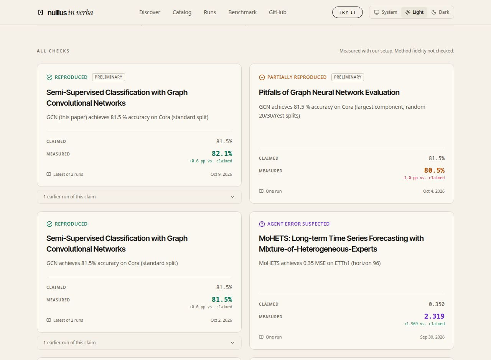
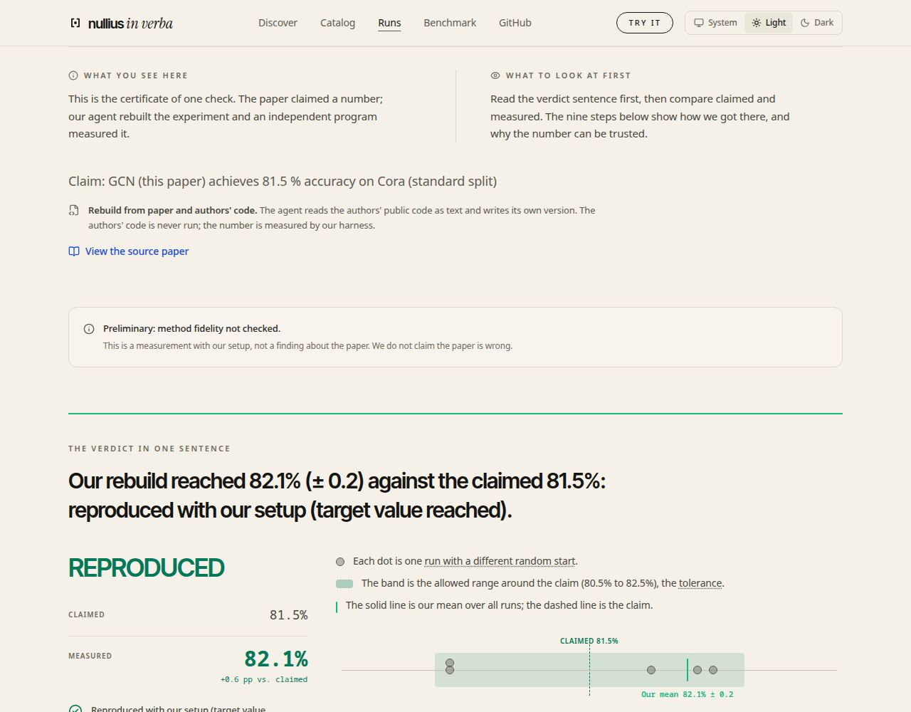
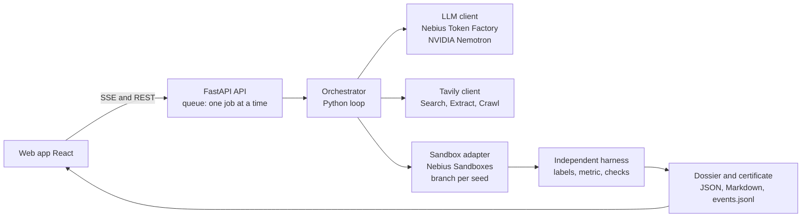

# Nullius

**Other agents fix code until the tests pass. Here, the paper is the test suite.**

*Nullius in verba* ("take nobody's word for it"): Nullius takes a claim from a machine-learning paper, rebuilds the experiment in an isolated sandbox and lets an independent harness measure the result. The verdict is a measurement, not an opinion.

**The problem.** Rebuilding a paper costs days of broken code and missing hyperparameters, and whether a claim holds is usually known only after someone has paid that price.

### What the benchmark shows (v4, 48 runs on Nebius Token Factory)

Nullius is a **high-precision checker**: when it says a target value was reached, it was; it has never reported a deliberately wrong claim as reproduced. It often does not reach the target.

| | Result | Status |
|---|---|---|
| **Precision** | **0 of 48** deliberately wrong claims reported as "reproduced" (also 0 of 48 in each of v2 and v3, three versions with different code) | pre-registered negative control |
| **Precision** | **7 of 7** "reproduced" verdicts agree with the reference solution | post hoc, small sample |
| **Recall** | **2 of 8** paper-claim units matched the reference verdict with Tavily, **1 of 8** without | pre-registered primary metric |

The misses are mostly near misses: 20 of 48 single real-claim verdicts are "partially reproduced" (within three times the tolerance). **Method fidelity was not checked**: "reproduced" means "target value reached according to the harness", not "method reproduced". Details: [Benchmark](#benchmark).

[Demo](TBD) | [Video](TBD) | Built for the Nebius x NVIDIA Global AI Hackathon (Coding and Agentic Engineering, Best Use of Tavily) | MIT | <https://github.com/Script-hpp/Nullius>



## Who uses it, and how

- **A reviewer** meets a paper that claims a number on a supported benchmark ("GCN reaches 81.5 % on Cora"). Nullius rebuilds the experiment and measures it over 10 seeds: [Kipf & Welling, reproduced 0.815 ± 0.011, about 10 minutes, 0.139 $ gross](web/public/data/kipf_gcn_2017/20261002-110746/zeugnis.md) (a catalog run of the same claim: 9.6 minutes, 0.074 $). The certificate lists the sources, the measurements and the branch tree.
- **An author** adds the badge of a finished check to the README: `[](<certificate-url>)`. The Evidence page of every run shows the snippet ("Add this badge to your README"). The badge says "reproduced with our setup" plus measured against claimed value and "method not checked", and links to the certificate.
- **A PhD student or ML team** checks the headline number of a paper before building on it, instead of discovering a gap after days of work. Discovery (Tavily) lists new papers on supported benchmarks.

**Honest scope.** Nullius checks papers that evaluate on benchmarks it already supports: Cora (Planetoid split), Cora with random splits, ETTh1 (horizon 96) and, since the dataset extension of 7 Oct 2026, CiteSeer (Planetoid split; its harness passed three reference solutions, but no agent run on it exists yet). PubMed, ETTh2, ETTm1 and ETTm2 are built but not released because a reference solution missed the pre-registered tolerance ([validation results](benchmark/experiments/results/datasets_v2_validation.md)). A new dataset needs a one-time task and harness; new papers on existing datasets work out of the box. CPU only, claims that run in minutes. "Reproduced" means the target value was reached; method fidelity is not checked. "Not reproduced" means not reached with our setup and says nothing yet about the paper.

## How we use NVIDIA Nemotron

Every reasoning and coding step is a call to an NVIDIA Nemotron model through one OpenAI-compatible endpoint (`src/repro_agent/llm.py`).

| Role | What it does | Model in production |
|---|---|---|
| `fast` | table and target-value extraction from paper text | Nemotron 3.5 Lightning (`nvidia/Nemotron-3_5-Lightning`) |
| `code` | writes and repairs the experiment script | Nemotron 3 Super 120B-A12B (`nvidia/nemotron-3-super-120b-a12b`) |
| `extract` | setup details with verbatim quotes from paper, README and repository files (same model as `code`) | Nemotron 3 Super |
| `reasoning` | research plan | Nemotron 3 Ultra 550B-A55B (`nvidia/Nemotron-3-Ultra-550b-a55b`) |

Nemotron plans and writes code; it never runs it. The sandbox runs it, the harness measures it. Every quote a model returns is re-checked against the source text and dropped if it does not occur there. Model IDs and routing are environment variables (`.env.example`).

## Where Nebius Token Factory helped

Stated only where the repository shows it:

- **One endpoint for every role.** Lightning, Super and Ultra sit behind the same OpenAI-compatible API, so switching provider is an environment change; provider-specific code lives only in the LLM client.
- **Usage you can reconcile.** Token counts from the API's `usage` field agreed with the console within its rounding (net 1.256 $ in our log vs 1.26 $ in the console on 29 Sep 2026; [`docs/research_log.md`](docs/research_log.md), "Cost tracking").
- **Cost control that worked.** Per-run limit, global budget with a cut-off (warning at 80 %, abort at 95 % before the call), retries with back-off, hard stop on billing or authentication errors.
- **Low cost per paper.** Catalog runs, gross incl. VAT (30 Sep 2026): SL-GCN on Cora-LCC 0.028 $ and 0.025 $ (10 seeds each), MoHETS on ETTh1 0.093 $ (3 seeds), from the `run_end` events in `web/public/data/disc_*/*/events.jsonl` (model cost only, Tavily excluded). The whole v4 benchmark (48 runs) cost 7.78 $ gross.

Feedback on Token Factory, the sandboxes and the NVIDIA models: [`docs/nebius_feedback.md`](docs/nebius_feedback.md).

## Other Nebius services: Sandboxes

All experiment code runs in **Nebius Sandboxes** (`contree-sdk`).

- **Real branching:** the base image (Python, numpy, scipy, torch) is built once as a snapshot; every seed, repair attempt and graph ablation is a branch of it. A failed attempt is rolled back for free.
- **Parallel seeds:** 20 parallel branches from one snapshot ran without errors in our test (higher was not tested).
- **Isolation:** the agent's training run has no network (`unshare -n`); the harness is copied in fresh afterwards.

## How we use Tavily

A normal run calls Tavily **live** at run time (`TAVILY_MODE=live`, the default). Every source is recorded with mode, timestamp, SHA-256 and length in the dossier, in `events.jsonl` and as `paper_text.json`, so a run stays traceable if a web page changes. The live and evidence views show a badge per Tavily call.

| Where | Endpoint | Purpose |
|---|---|---|
| **Discovery (live catalog)** | Search (github.com, arxiv.org, openreview.net), Extract | finds new papers on supported benchmarks, reads protocol and results sections, proposes claims with a verbatim quote |
| Read claims (role 2) | Extract on the arXiv text | tables with target values, checked by quote and by table column |
| Material and setup details (roles 1, 4) | Search for the repository, Extract on the README, sandbox clone of chosen files | hyperparameters and data splits, each with a quote from paper, README or repository |
| Error search (role 5) | Search with the failing line | solution hint for the code repair |
| Community check (roles 3, 6) | Search, limited Crawl of repository issues | after the verdict: "What others found" and "Possible explanations", each with a quote. **Reported only, never changes the verdict** (`src/repro_agent/community.py`) |

Tavily's effect on the benchmark is small (see below); its main role in the product is Discovery and the traceable sources. The Tavily key is scarce, so tests and the benchmark use stored copies (`--offline`, `TAVILY_MODE=fixture`; in v4 only role 5 was live).

**Not built:** objection findings turned into their own experiments (for example one branch per seed claimed by an issue), Tavily Research for citable sources (role 7), and the "re-run" mode that executes the authors' code.

## Product tour

**Discover** (Tavily finds new papers on supported benchmarks and proposes claims), **Catalog** (candidates that ran once through the full loop; live runs need no sign-in; one run at a time, daily and per-IP limits, and they pause when the budget floor is reached, then the recorded run is shown), **Live run**, A reproduction streams over Server-Sent Events: Tavily findings, plan, code, branches, measurements and repairs as they happen. If a live run cannot start, the UI offers the last finished run as a replay. **Evidence**: the certificate is a page of its own: what Tavily found and the target value on the left, what the sandbox measured on the right, branch tree, step-by-step replay. The web app is a static React app (`web/`); live controls appear only when the API is reachable.



## How it works



Nemotron is the brain, the sandbox is the lab, Tavily is the researcher, the orchestrator is the lab head. **The model never executes code; the sandbox never thinks.** Per claim: Tavily reads the target value and setup details, Nemotron plans and writes the code, the sandbox runs seed 0 in a branch, the harness scores it, checks run, the code is repaired if needed, then the remaining seeds run in parallel branches with exactly that code. The verdict rests on the **mean over all seeds** against a tolerance fixed before the run.

- **Independent harness.** The agent writes `/output/predictions.csv` (`id,prediction`) and nothing else counts. The harness is copied in fresh, loads the test labels itself from the original dataset, checks plausibility and computes the metric with fixed, tested code.
- **Leak protection** (recorded in the dossier under `isolation`): no network in training (`unshare -n`), a static code check rejects network access, downloads, process spawning and dynamic code, test labels never enter the agent's dataset.
- **Two axes.** Axis 1 is the result (reproduced / partially / not reproduced / agent fault suspected / not reproducible with our setup). Axis 2 is method fidelity (yes / partially / no / not checked) and is **"not checked"** in the benchmark (see Limits).
- **Checks and repairs.** Smoke run on a tiny subset, trivial baselines (a result below the best one is flagged "agent fault suspected", not blamed on the paper), a graph ablation for graph models (code run again without edges; validation 9/10, [`results/ablation_gcn_validation.md`](benchmark/experiments/results/ablation_gcn_validation.md)), crash repair from the end of stderr, a plan validator, a deterministic table-column check. At most `MAX_ATTEMPTS_PER_CLAIM` attempts, then "not reproducible with our setup" with the documented attempts.

## Benchmark

**Scope: small graph and time-series models that run on CPU in minutes.** Six papers, eight paper-claim units, each with and without Tavily, three fresh generations per unit and arm, plus a deliberately wrong **placebo** claim per run (for example 88 % on Cora). 48 runs, product configuration, stored Tavily results in both arms. Rules fixed before the first run ([`benchmark_v2.md`](benchmark/experiments/benchmark_v2.md), v4 changes in [`benchmark_v4.md`](benchmark/experiments/benchmark_v4.md)); results in [`results/benchmark_v4.md`](benchmark/experiments/results/benchmark_v4.md), code `bf520c1` and `2b13b31`, numbers exported by `scripts/export_benchmark_json.py` (also shown on the Benchmark page of the web app).

**1. Precision first.** No placebo was ever reported as "reproduced": 0 of 48 in v4 and, with different code, 0 of 48 in each of v2 and v3. All 16 placebo majorities in v4 say "not reproduced". Every "reproduced" verdict for a real claim in v4 (7 of 7) matched our reference solution (post hoc, small sample).

**2. Primary metric** (pre-registered): per unit, the majority verdict of three generations against the reference verdict. With Tavily **2 of 8** units agree (Kipf-GCN, Shchur-GCN), without Tavily **1 of 8** (DLinear). The pre-registered expectation for v4 (more agreement than v3 in at least one arm) was **not met**.

**3. How to read it.** The errors are one-sided: Nullius often misses the rebuild but has not confirmed a wrong number. A miss means "not reached with our setup" and usually points at the agent, not at the paper. Misses are mostly consistent near misses: the median distance to the target value is 0.017 with and 0.029 without Tavily (post hoc), "partially" is the most frequent miss. What improved from v2 to v4 is stability (no unit without a majority) and failures (1 of 48 real-claim verdicts without a measurement). Tavily makes no measurable difference at this sample size (2 vs 1 of 8).

| Unit (task) | Reference verdict (source) | Majority without Tavily | Majority with Tavily | Placebo detected (both arms) |
|---|---|---|---|---|
| Kipf & Welling 2017, GCN (Cora) | reproduced (R) | not reproduced | **reproduced** | yes |
| Wu et al. 2019, SGC (Cora) | reproduced (R) | partially | not reproduced | yes |
| Zeng et al. 2023, DLinear (ETTh1) | reproduced (R) | **reproduced** | partially | yes |
| Zeng et al. 2023, NLinear (ETTh1) | reproduced (R) | not reproduced | not reproduced | yes |
| Shchur et al. 2018, GCN, random splits (Cora) | reproduced (R, H) | partially | **reproduced** | yes |
| Shchur et al. 2018, GAT, random splits (Cora) | reproduced (R, H) | partially | partially | yes |
| Veličković et al. 2018, GAT (Cora) | reproduced (R) | partially | partially | yes |
| Veličković et al. 2019, DGI (Cora) | partially (R) | not reproduced | not reproduced | yes |
| **Units agreeing with the reference** | | **1 of 8** | **2 of 8** | **8 of 8 / 8 of 8** |

| | v2 | v3 | v4 |
|---|---|---|---|
| Units agreeing with the reference, without / with Tavily | 2 / 2 of 8 | 2 / 2 of 8 | 1 / 2 of 8 |
| Placebo verdicts "reproduced", of 48 | 0 | 0 | 0 |
| Placebo majorities "not reproduced", of 16 | 13 | 14 | 16 |

Each version ran different code; v2 and v3 in full: [`docs/benchmark_history.md`](docs/benchmark_history.md). Every v4 miss is traced to its cause in [`failure_analysis_v4.md`](benchmark/experiments/failure_analysis_v4.md) and [`results/failure_log_v4.md`](benchmark/experiments/results/failure_log_v4.md). One v4 process died on a sandbox connection error and was restarted with unchanged code ([`benchmark_v4_incidents.md`](benchmark/experiments/results/benchmark_v4_incidents.md)).

**Limits, stated up front.**
- **Method fidelity is not checked.** The LLM checker failed its pre-registered threshold in three calibrations (5/10, 7/10, 8/11; [`calibration_fidelity_v1.md`](benchmark/experiments/results/calibration_fidelity_v1.md), `_v2.md`, `_v3.md`). Axis 2 stays "not checked", every verdict is provisional, and the benchmark counts axis 1: "target value reached according to the harness". Only the graph ablation says something about method use, for graph models.
- **No real negative case.** Dacrema et al. (2019) was dropped (on MovieLens-1M the paper itself reproduces NeuMF) and Shwartz-Ziv & Armon was scoped and dropped ([`shwartz_ziv_scoping.md`](benchmark/experiments/shwartz_ziv_scoping.md)). The placebo claims are constructed and do not replace a real negative case.
- **Reference verdicts.** (R) = our own reference solution run through the same harness, so not independent of our protocol choices; (H) = independent re-measurement in a critique paper (Shchur et al., GCN and GAT).
- **Small numbers.** Eight units are counts, not a significance test. Both arms get the same target value, so a difference comes from setup details and prompt length.
- Three datasets, CPU only; DGI was meant as a Tavily holdout and is no longer clean ([`tavily_v2_holdout.md`](benchmark/experiments/tavily_v2_holdout.md)).

All numbers in this README and in the video come from production runs on Token Factory.

## Related work

- **PaperBench** ([Starace et al., 2025](https://arxiv.org/abs/2504.01848)): agents replicate 20 ICML 2024 Spotlight and Oral papers from scratch, graded against hierarchical rubrics (8,316 gradable sub-tasks) co-developed with the authors, using an LLM judge.
- **CORE-Bench** ([Siegel et al., 2024](https://arxiv.org/abs/2409.11363)): 270 tasks from 90 papers; agents run the code and data supplied with a paper and answer questions about the results.
- **Difference.** Nullius is judged against the *paper's own claim*, not a rubric. The number comes from an independent harness the agent cannot touch, and a verdict can say "not reproduced". Claims run on CPU in minutes, so a check costs cents and can be watched live. We test our own components with rules fixed beforehand and report the failures.

## Setup and usage

Requirements: Python 3.11+, [uv](https://docs.astral.sh/uv/), Node 22 for the web app, a Nebius Token Factory key, a Nebius Sandboxes project and a Tavily key.

```bash
cp .env.example .env                 # add NEBIUS_API_KEY, NEBIUS_PROJECT_ID, TAVILY_API_KEY, set LLM_PROVIDER=tokenfactory
uv sync

# one paper, all its claims (benchmark/papers.yaml)
LLM_PROVIDER=tokenfactory uv run repro-agent kipf_gcn_2017
#   --no-tavily  no Tavily at all   --offline  stored Tavily results   --fresh  no LLM cache

# web app (development) and API (live runs, SSE)
cd web && npm ci && npm run dev
uv run uvicorn repro_agent.api:app --port 8000

# tests (no network, no cost)
uv run python -m pytest -m "not integration"
cd web && npm run build && npm run lint && npm test
```

Configuration lives in `.env` (`LLM_PROVIDER`, `SANDBOX_BACKEND`, budgets, VAT rate, `TAVILY_MODE`). Runs are written to `runs/<paper>/<timestamp>/`; `scripts/export_site_data.py` copies selected runs to `web/public/data` (publish only production runs). The API needs no access code. It limits live runs to one at a time, per day and per IP, pauses them when the remaining model budget or Tavily credits fall below a floor (`LIVE_MIN_BUDGET_USD`, `LIVE_MIN_TAVILY_CREDITS`; status at `GET /api/status`), and keeps all keys on the server. `Dockerfile` builds API and web app into one container; hosting steps are in [`docs/deploy.md`](docs/deploy.md).

## Limitations and roadmap

- CPU only, claims under ten minutes; no LLM papers, no PDF image analysis. Each new dataset needs a task and a harness once.
- Mode "rebuild" only: the agent writes its own code and takes only cited details from paper and repository. Running the authors' code ("re-run") tests something different and is not built.
- The graph ablation covers graph models only; DLinear and NLinear would need a decomposition or normalisation ablation.
- **Roadmap:** a method-fidelity checker that passes calibration; more tasks and datasets; findings from the community check turned into their own experiments; a real negative case; notifying paper authors with the certificate ([`docs/idea_author_notification.md`](docs/idea_author_notification.md)).

## Licence

MIT, see [`LICENSE`](LICENSE).

Datasets are not redistributed; the harness downloads them from their sources at run time. The `kimiyoung/planetoid` repository (Cora, CiteSeer, PubMed raw files) carries an MIT `LICENSE` (Copyright 2016 Zhilin Yang); the `zhouhaoyi/ETDataset` repository (ETT files) carries a `LICENSE` file with Creative Commons Attribution-NoDerivatives 4.0 International. Both checked on 7 Oct 2026 by reading the files in those repositories; we did not check licences of other sources.
